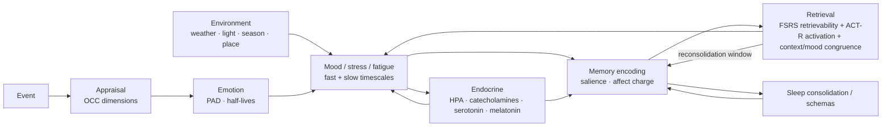

<div align="center">

# Thymos

**Memory fades. Mood tides. Thymos remembers why.**

A local-first, inspectable memory control plane that couples forgetting curves, appraisal-based affect, endocrine modulation, and real-world environment.

[中文](README.md) · [Product definition (Chinese)](docs/PRODUCT.md) · [Tutorial (Chinese)](docs/TUTORIAL.md) · [MCP (Chinese)](docs/MCP.md) · [P0–P2 upgrade (Chinese)](docs/UPGRADE_P0_P2.md) · [Strategy and landscape (Chinese)](docs/STRATEGY.md) · [Research](docs/RESEARCH.md) · [Design](docs/DESIGN.md) · [Experiments](docs/EXPERIMENTS.md) · [Evaluation (Chinese)](docs/EVALUATION.md) · [Naming](docs/NAMING.md) · [Roadmap](docs/ROADMAP.md) · [Three-fix retest (Chinese)](docs/LOCAL_LLM_FIXES.md) · [Four-fix retest (Chinese)](docs/FACT_EMOTION_FIXES.md)


</div>

> **Status: v0.3.3, local research sandbox with a control-plane MVP.** This is not a clinically validated model of emotion, and it is not conscious. It is a set of inspectable dynamical hypotheses: what if memory, affect, hormones, sleep and weather shared one clock? 0.3.3 fixes nested LLM appraisal payloads and the dimension-to-label path, and adds a `/api/appraise` debug endpoint; 0.3.2 introduced the optional `LLMAppraiser` and one-appraisal reuse. The lexical rules remain the deterministic default and fallback. Query-intent routing, affect gating, four memory operators, hard context budgets and an audit trace remain. It is still not production-grade memory.

---

## Why

Most agent memory systems answer one question: *how do we put more context back into the prompt?*

Thymos asks three different ones:

1. **What should be forgotten?** A memory is not present/absent; it has a retrievability curve that changes with time and review.
2. **Why does the same event feel different today and three months later?** Emotion is fast, mood is slow, endocrine state is slower, and recall can rewrite the memory itself.
3. **Should weather, season, place and sleep affect an agent at all?** If so, how much, in what direction, and how can it be audited?

The system couples five layers on one clock:



## Quick start

Python 3.10+. Zero runtime dependencies.

```bash
git clone https://github.com/agentforgehu/thymos-engine.git
cd thymos-engine
python -m venv .venv
source .venv/bin/activate        # Windows: .venv\Scripts\activate
pip install -e ".[dev]"
python -m thymos --offline demo
python -m thymos --offline serve   # http://127.0.0.1:8787/
```

`--offline` uses deterministic synthetic weather. Omit it to call Open-Meteo (no API key required).

## Minimal example

```python
from thymos import Profile, Thymos, ThymosConfig

mind = Thymos(
    profile=Profile(name="Ada", location_name="Shanghai", latitude=31.23, longitude=121.47),
    config=ThymosConfig(offline=True, seed=7),
)

item = mind.perceive(
    "The review passed and the team endorsed my proposal",
    importance=0.85,
    tags=["work"],
)
print(item.valence, item.stability)

mind.tick(6 * 3600)
for hit in mind.recall("review work", top_k=3):
    print(hit.score, hit.retrievability, hit.memory.content)

print(mind.consolidate(7.5))
print(mind.render_context(mind.recall("review", top_k=3)))
```

## Control plane

```python
from thymos import AgentMemory, Profile, ThymosConfig

memory = AgentMemory(
    ".thymos/agent.json",
    profile=Profile(name="Ada", location_name="Shanghai"),
    config=ThymosConfig(offline=True, seed=7),
)
plan = memory.plan("What is my name?", max_chars=600)
print(plan["intent"]["label"])        # factual
print(plan["affect"]["mood_weight"])  # 0.0
print(plan["operators"])              # fact / episode / graph / summary
print(plan["context"])
```

Factual and technical queries disable mood congruence and hide the simulated-affect block;
supportive queries keep it. The policy is explicit in `src/thymos/policy.py`, and the
audit is returned by `memory.plan()`, `GET /api/audit`, and MCP `memory_plan`.

## What is modelled

| Layer | Mechanism | Implementation |
|---|---|---|
| Trace | forgetting, spacing, testing | FSRS power-law curve; stability grows on successful recall |
| Retrieval | frequency, recency, cues, spreading activation, mood congruence | ACT-R base-level + context similarity + sparse association graph |
| Appraisal | OCC-style dimensions | relevance, desirability, novelty, certainty, control, agency, norms |
| Emotion | discrete labels + PAD | 13 labels; fast variable, half-lives 5–480 min |
| Mood | slow integrator, homeostasis, inertia | first-order dynamics; endocrine, weather, circadian biases |
| Endocrine | eight hormone-like pools + HPA cascade | adrenaline, noradrenaline, cortisol, dopamine, serotonin, oxytocin, melatonin, endorphin |
| Environment | weather, light, season, place, sleep debt | Open-Meteo + synthetic fallback; bounded effects |
| Consolidation | sleep replay, semantic schemas | stability boost; repeated themes become semantic memories |
| Reconsolidation | labile window after recall | affect charge can be rewritten; halved outside the window |

Formal equations and parameter provenance: [docs/DESIGN.md](docs/DESIGN.md).

## What the experiments show

```bash
python experiments/run_experiments.py
```

| Experiment | Key result |
|---|---|
| Forgetting-curve fit | stretched exponential RMSE **0.0225**, vs 0.0567 exponential, 0.1896 FSRS |
| Spacing | 30-day retention **38% vs 66%** after the same five reviews |
| Acute stress | cortisol peak at **70 min**; retrieval gain falls to **0.759** |
| Weather coupling | mean mood difference **0.012**, max **0.028** over 30 days |
| Emotional memory | half-life **9.6 / 15.8 / 35.9 days** for neutral / mild / high-arousal |

These validate **internal consistency**, not human psychology. See [docs/EXPERIMENTS.md](docs/EXPERIMENTS.md) for methods and threats to validity.

## How it differs

| System | Memory | Explicit forgetting | Affect dynamics | Endocrine | Environment | Reproducible experiments |
|---|---|---|---|---|---|---|
| Mem0 | extraction + vector/graph | partial | — | — | — | partial |
| Zep / Graphiti | temporal knowledge graph | time validity | — | — | — | partial |
| Letta / MemGPT | hierarchical context | context eviction | — | — | — | partial |
| Generative Agents | memory stream | recency decay | simple | — | — | yes |
| ALMA / WASABI | — | — | appraisal + PAD | — | — | partial |
| **Thymos** | **trace + graph + schema + control plane** | **FSRS curve** | **fast emotion + slow mood + query gate** | **8 pools + HPA** | **weather/light/season** | **236 tests + reproducible experiments** |

Thymos does not compete on memory-recall benchmarks. It competes on **dynamical coherence, inspectability and reproducibility**.

## Design principles

Local-first by default. Zero runtime dependencies. Deterministic given a seed and clock. Every retrieval exposes its `components`. Environmental effects are bounded to ±0.12 on mood. No diagnosis, no emotional manipulation, no claim of consciousness.

## Limitations

The appraisal layer is a dictionary heuristic. Embeddings are hashed n-grams, not semantic vectors. Endocrine values are relative units, not blood concentrations. Most parameters are engineering estimates, not fitted constants. There has been no user study. Do not use it to score real people.

## License

MIT. See [LICENSE](LICENSE).
