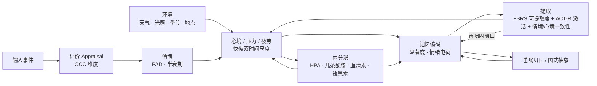
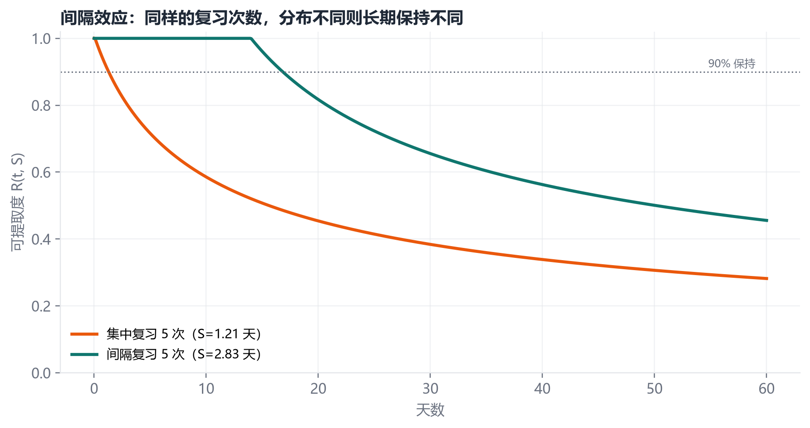
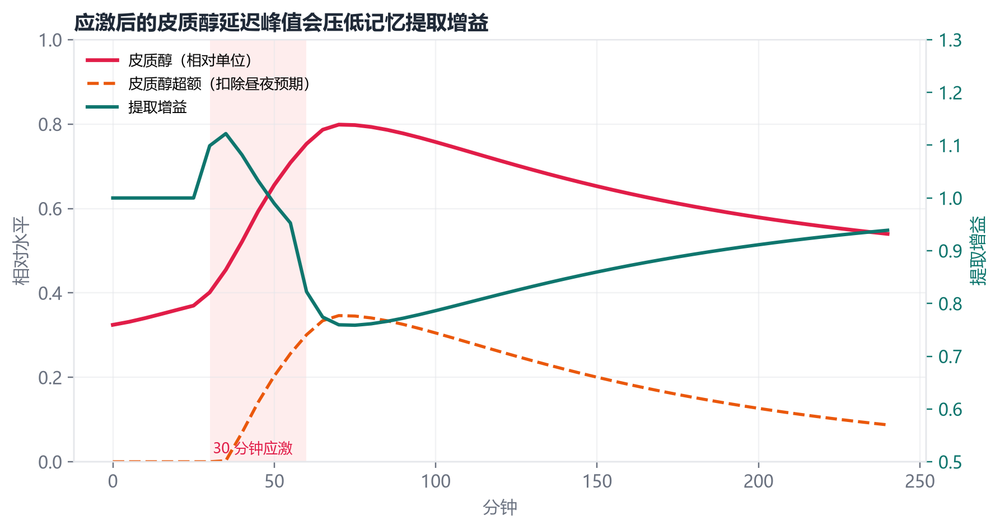

<div align="center">

# Thymos · 心潮

**记忆会褪色，情绪会涨落。Thymos 让 Agent 记得为什么。**

一个本地优先、可解释、可复现的「情绪 × 记忆 × 内分泌 × 环境」耦合引擎。

[English](README.en.md) · [教程](docs/TUTORIAL.md) · [MCP 接入](docs/MCP.md) · [P0–P2 升级](docs/UPGRADE_P0_P2.md) · [研究综述](docs/RESEARCH.md) · [设计文档](docs/DESIGN.md) · [实验报告](docs/EXPERIMENTS.md) · [本地实测](docs/LOCAL_LLM_TEST.md) · [50 轮实测](docs/LOCAL_LLM_50_TEST.md) · [小上下文实测](docs/BUDGET_CONTEXT.md) · [Held-out 评测](docs/results/heldout_eval.md) · [不足与审计](docs/GAPS.md) · [验证协议](docs/EVALUATION.md) · [命名说明](docs/NAMING.md) · [路线图](docs/ROADMAP.md) · [集成指南](docs/INTEGRATION.md)


</div>

> **状态：v0.2.0 本地实验版。** 这不是经过临床验证的心理学模型，也不是“有意识”的系统。它是一个可检查的动力学沙盒：把记忆科学、评价理论和内分泌调节放进同一组状态变量里，观察它们如何互相拉扯。0.2.0 重点补的是事实可靠性、安全边界、MCP 接入与 held-out 评测，而不是更多情绪变量。API 仍可能变化。

---

## 三句话

1. **记忆不是存不存，是有深浅。** 不碰的事会自然淡掉，常提的越记越牢；系统自己筛，不靠手工删。
2. **心情有层次，不是一个分数。** 情绪一两小时就退，心境是好几天的慢变量，底下还有皮质醇、血清素在托着；所以它会“缓过来”，不是切一个标签。
3. **每次回忆都会改写那条记忆。** 同一件事今天想起来和三个月后想起来，情绪电荷不一样；回忆不是读取文件，是再巩固。

短板也写在明面上：**中文召回一般，参数还没调过**。当前嵌入是哈希 n-gram，评价是词典启发式；它适合做原型、研究和可解释的基线，不是开箱即用的生产记忆层。

---

## 为什么做 Thymos

大多数 Agent 记忆系统在回答一个问题：**怎样把更多信息塞回上下文？**

Thymos 想回答另外三个问题：

1. **什么应该被忘掉？** 一条记忆不是“存在/不存在”，而是有一条随时间和复习变化的可提取度曲线。
2. **为什么同一件事，今天想起和三个月后想起，感受不一样？** 情绪是快变量，心境是慢变量，内分泌是更慢的背景；回忆会改写记忆本身。
3. **天气、季节、地点和睡眠，究竟该不该影响一个 Agent？** 如果影响，应该有多小、以什么方式、如何被审计？

因此 Thymos 把五层放在同一个时钟上：



一句话：**事件先被评价，评价产生情绪，情绪和内分泌一起决定这条记忆有多深；之后每一次回忆，都要同时穿过遗忘曲线、线索匹配和当下心境。**

---

## 30 秒跑起来

需要 Python 3.10+。运行时零依赖。

### Windows PowerShell

```powershell
git clone https://github.com/agentforgehu/thymos-engine.git
cd thymos-engine
python -m venv .venv
.\.venv\Scripts\Activate.ps1
pip install -e ".[dev]"
python -m thymos --offline demo
```

### macOS / Linux

```bash
git clone https://github.com/agentforgehu/thymos-engine.git
cd thymos-engine
python3 -m venv .venv
source .venv/bin/activate
pip install -e ".[dev]"
python -m thymos --offline demo
```

`--offline` 使用确定性的合成天气，便于复现实验；去掉它就会调用 Open-Meteo（无需 API Key）。

### 打开可视化面板

```bash
python -m thymos --offline serve
```

浏览器会打开 `http://127.0.0.1:8787/`。面板可以记录事件、观察心境曲线与八种激素样变量、按线索回忆、推进时间、模拟睡眠巩固。

### 接进自己的 Agent（MCP）

```bash
python -m thymos.mcp_server --state .thymos/mcp.json --offline
```

这是一个 stdio MCP server，提供 `memory_context`、`memory_observe`、`memory_recall`、`memory_correct_fact`、`memory_delete_fact`、`memory_snapshot` 六个工具。宿主 Agent 每轮先取记忆、回答后按需写入；记忆块带 `<memory trust="untrusted">` 边界，不会被当成系统指令。完整配置见 [docs/MCP.md](docs/MCP.md)。

---

## 最小示例

```python
from thymos import Profile, Thymos, ThymosConfig

mind = Thymos(
    profile=Profile(name="小林", location_name="上海", latitude=31.23, longitude=121.47),
    config=ThymosConfig(offline=True, seed=7),
)

# 一件重要的事：评价 -> 情绪 -> 内分泌脉冲 -> 记忆编码
item = mind.perceive(
    "项目评审通过了，大家认可我的方案，我松了一口气",
    importance=0.85,
    tags=["工作"],
)
print(item.valence, item.stability)      # 情绪电荷 / 初始稳定度（天）

# 六小时后，按线索回忆
mind.tick(6 * 3600)
for hit in mind.recall("评审 工作", top_k=3):
    print(hit.score, hit.retrievability, hit.memory.content)

# 睡一觉：重放重要记忆、抽象图式
print(mind.consolidate(7.5))

# 完整可审计状态
snapshot = mind.snapshot()
print(snapshot["affect"])
print(snapshot["endocrine"]["levels"])
```

输出不是一句“我记住了”，而是一组可以追问的数：这条记忆的稳定度是多少天、当前可提取度是多少、为什么它排在第一、当下皮质醇是否高于昼夜预期、天气贡献了多少心境偏置。

---

## 接进自己的 Bot

如果你的 Bot 只需要“回复前回忆、回复后记录”，用 `AgentMemory` 三个调用就够：

```python
from thymos import AgentMemory, Profile, ThymosConfig

memory = AgentMemory(
    ".thymos/my_bot.json",
    profile=Profile(name="用户", location_name="上海", timezone="Asia/Shanghai"),
    config=ThymosConfig(offline=True, seed=7),
)

context = memory.context(user_text, top_k=3, min_score=0.30, max_chars=900)  # 回复前；硬预算
reply = my_llm(system_prompt + context, user_text)           # 你的 LLM
memory.observe(user_text)                                    # 回复后：只记用户事实
memory.end_session(7.5)                                      # 夜间/退出
```

只有当回复里包含承诺或重要的自我披露时，才传第二个参数 `assistant_text`；不要把每条模型回复都写回记忆。本地小模型用 `max_chars` 控制预算，不要直接拼完整历史。

完整原理、记忆存储格式、遗忘公式、情绪评价和 LLM 边界，见
[从 0 到 1 教程](docs/TUTORIAL.md)；接口细节见 [集成指南](docs/INTEGRATION.md)。
可运行示例：`python examples/chatbot_demo.py`。

### 接真实 LLM

`examples/llm_chat.py` 是零依赖的 DeepSeek / Ollama 版本，支持交互和脚本化演示：

```bash
# DeepSeek（PowerShell 先设置 $env:DEEPSEEK_API_KEY）
python examples/llm_chat.py --provider deepseek

# Ollama（先 ollama serve，并 pull 一个模型）
python examples/llm_chat.py --provider ollama --model qwen2.5:7b

# 中文语义召回：用 Ollama 的 bge-m3 替换默认哈希 n-gram
ollama pull bge-m3
python examples/llm_chat.py --provider ollama --model qwen2.5:7b --embedding ollama --embedding-model bge-m3

# 不配置 LLM 也能看完整流程的脚本化演示
python examples/llm_chat.py --demo --provider ollama --model qwen2.5:7b
```

它默认只把“用户事实”写回记忆，不保存每条助手回复；也不把注入 Top-k 当成复习（要复习加 `--review`）。默认 embedding 是零依赖哈希；换 `--embedding ollama` 后，旧状态会在首次 `recall` 时自动重算向量，不需要手工迁移。

---

## 它到底建模了什么

| 层 | 机制 | 关键实现 |
|---|---|---|
| 记忆痕迹 | 遗忘曲线、间隔复习、测试效应 | FSRS 幂律曲线；稳定度随成功提取增长 |
| 提取 | 频率、近因、线索、关联扩散、心境一致性 | ACT-R 基础激活 + 情境相似度 + 稀疏关联图 |
| 评价 | OCC 风格的评价维度 | 目标相关性、可取性、新异性、确定性、控制感、 agency、规范 |
| 情绪 | 离散标签 + PAD 连续量 | 13 类情绪；快变量，半衰期 5–480 分钟 |
| 心境 | 慢积分、稳态回拉、情绪惯性 | 一阶动力学；受内分泌、天气、昼夜节律影响 |
| 内分泌 | 八个激素样变量 + HPA 级联 | 肾上腺素、去甲肾上腺素、皮质醇、多巴胺、血清素、催产素、褪黑素、内啡肽 |
| 环境 | 天气、光照、季节、地点、睡眠债 | Open-Meteo 实时数据；离线合成天气；效应有界 |
| 巩固 | 睡眠重放、语义图式 | 稳定度提升；重复出现的主题抽象为 semantic memory |
| 再巩固 | 回忆后短暂可改写窗口 | 窗口内情绪电荷改写更强，窗口外减半 |

完整公式、参数来源和耦合矩阵见 [docs/DESIGN.md](docs/DESIGN.md)。

---

## 与既有系统的差异

| 系统 | 记忆组织 | 显式遗忘 | 情绪动力学 | 内分泌 | 真实环境耦合 | 可复现实验 |
|---|---|---|---|---|---|---|
| Mem0 | 抽取 + 向量/图 | 部分 | — | — | — | 部分 |
| Zep / Graphiti | 时序知识图 | 时间有效性 | — | — | — | 部分 |
| Letta / MemGPT | 分层上下文 + 自编辑 | 上下文淘汰 | — | — | — | 部分 |
| Generative Agents | memory stream | 近因衰减 | 简单 | — | — | 是 |
| ALMA / WASABI | — | — | 评价 + PAD | — | — | 部分 |
| **Thymos** | **痕迹 + 关联图 + 图式** | **FSRS 曲线** | **快情绪 + 慢心境** | **8 变量 HPA** | **天气/光照/季节** | **是，104 项测试 + 5 个实验** |

Thymos 不追求在 LoCoMo 之类的记忆基准上刷分。它关心的是**动力学是否自洽、参数是否可解释、行为是否可复现**。如果你要的是“最高召回率”，请用专用记忆系统；如果你要的是“一个会遗忘、会受影响、能解释自己为什么想起这件事的 Agent 内核”，Thymos 是一个可改造的起点。

---

## 怎么证明它有用

记忆命中率、情绪词命中率都不能证明业务提升。正确做法是**同一个 LLM、同一套 prompt、同样的 token 与延迟预算，只换记忆层**，做任务级反事实比较：客服看首次解决率（FCR）与 7/30 天重复 contact，陪伴型看“感知被记得”和用户福祉，留存只能当次指标。先用 100–200 个历史多会话案例做离线回放，再做按客户/用户随机分组的线上 A/B。

完整协议、样本量计算、对照组设计和 go/no-go 标准见 [docs/EVALUATION.md](docs/EVALUATION.md)。

仓库带一个最小回放骨架 [`experiments/replay_harness.py`](experiments/replay_harness.py)：同一批多会话 case 分别跑无记忆、全量 transcript、摘要、向量 RAG、Thymos，输出成功/假记忆标记、prompt 字符数和延迟。先用 `--llm mock` 验证管线，再接真实模型。

---

## 实验一瞥

所有实验可用一条命令重跑：

```bash
python experiments/run_experiments.py
python experiments/retrieval_benchmark.py --embedding hash
python experiments/replay_harness.py --llm mock
```

指标写入 [`docs/experiments.json`](docs/experiments.json)，图写入 [`docs/figures/`](docs/figures/)。

| 实验 | 关键结果 |
|---|---|
| 遗忘函数拟合 | 拉伸指数 RMSE **0.0225**，优于指数 0.0567 与 FSRS 0.1896 |
| 间隔效应 | 同样复习 5 次，30 天保持率 **38% vs 66%** |
| 急性应激 | 皮质醇峰值在应激后 **70 分钟**；提取增益最低降至 **0.759** |
| 天气耦合 | 30 天心境平均绝对差 **0.012**，最大 **0.028**（效应刻意保持很小） |
| 情绪记忆 | 半衰期：中性 **9.6 天** / 轻度 **15.8 天** / 高唤醒 **35.9 天** |
| 中文 embedding 检索 | 12 条基线：hash recall@1 **0.417** / recall@3 **0.750** / MRR **0.572**；可用 `--embedding ollama` 对比 bge-m3 |
| 小上下文记忆 | 900/600 字符预算、50 轮：Thymos **16/16**；最近对话基线 **7/16**（见 [BUDGET_CONTEXT.md](docs/BUDGET_CONTEXT.md)） |





> 重要：这些数字验证的是**实现内部自洽**，不是对人类心理的测量。实验设计和威胁见 [docs/EXPERIMENTS.md](docs/EXPERIMENTS.md)。

---

## 命令行

```text
python -m thymos init --name 小林 --city 上海
python -m thymos perceive "今天面试通过了，很开心" --importance 0.9 --tags 工作
python -m thymos recall "面试" --top-k 5
python -m thymos tick --hours 6
python -m thymos consolidate --hours 7.5
python -m thymos snapshot
python -m thymos serve
python -m thymos demo
```

状态默认保存在 `.thymos/state.json`，是普通 JSON，可 diff、可备份、可手工检查。

---

## 设计原则

1. **本地优先。** 默认不联网；只有显式启用天气时才发送粗略经纬度。没有账号、没有遥测。
2. **零运行时依赖。** 核心只用标准库，方便嵌入、审计和长期保存。
3. **确定性。** 同一 seed、同一输入、同一时间戳，输出一致。
4. **可解释。** 每个判断都带 `components`：语义、标签、地点、天气、时段、心境、基础激活、关联扩散。
5. **效应有界。** 天气对心境的影响被限制在 ±0.12；任何单一因素都不允许“决定”一个人。
6. **不诊断、不替代。** 这是模拟与交互设计工具，不是心理评估、医疗建议或情感陪伴的替代品。

---

## 局限

- 评价层 v0.1 使用**词典启发式**，只能作为离线基线；正式使用应接入结构化评价或 LLM，并保留审计字段。
- 内分泌是**相对单位**，不是血液浓度；参数是文献先验与工程估计的混合，不能用于医学推断。
- 情绪半衰期、心境时间常数等是**可调参数**，不是普遍常数；个体差异远大于均值。
- 天气效应在文献中平均很小、个体差异很大；本系统刻意保守，但仍可能让用户觉得“被代表”。
- 记忆检索的嵌入是**哈希 n-gram**，只保证可复现，不保证语义质量；生产环境应替换为真实嵌入。
- **中文召回一般**：哈希 n-gram 对同义改写、跨句指代和长距离语义的召回有限；12 条中文基线为 recall@1 0.417 / recall@3 0.750 / MRR 0.572（`experiments/retrieval_benchmark.py`）。中文场景建议加 `--embedding ollama --embedding-model bge-m3`，或换成自己的 embedding。
- **参数还没调过**：默认值是文献先验与工程估计的混合，没有做全局敏感性分析、参数恢复或个体化校准；不要把它当成“已经调好的最优参数”。
- 没有做用户研究，也没有与临床量表对照。不要用它给真实的人打分。

伦理与安全边界见 [docs/ROADMAP.md](docs/ROADMAP.md) 与 [docs/RESEARCH.md](docs/RESEARCH.md)。

---

## 项目结构

```text
src/thymos/
  types.py        数据模型（Appraisal / Emotion / MemoryItem / EnvironmentState）
  forgetting.py   FSRS 曲线、稳定度更新、Ebbinghaus 数据
  retrieval.py    ACT-R 激活、情境相似度、心境一致性
  appraisal.py    OCC 规则、文本启发式评价
  affect.py       快情绪 / 慢心境 / 压力 / 适应负荷
  endocrine.py    八变量池 + CRH→ACTH→皮质醇级联 + 昼夜节律
  environment.py  太阳高度、昼长、季节、天气→心境映射
  weather.py      Open-Meteo 客户端 + 缓存 + 合成天气
  memory.py       痕迹存储 + 稀疏关联图
  facts.py        多值事实、事件时间、纠正/退休
  safety.py       PII 脱敏、注入边界
  tokens.py       保守 token 预算
  sqlite_store.py 可选 SQLite WAL 存储
  mcp_server.py   零依赖 stdio MCP
  llm_extract.py  可选 LLM 事实抽取
  engine.py       编排、持久化、巩固、快照
  agent.py        AgentMemory 门面（context / observe / end_session）
  api.py          标准库 HTTP API
  dashboard.html  零依赖可视化面板
  cli.py          命令行
experiments/      五个实验 + 检索基线 + 回放 harness + held-out 评测
tests/             104 项测试
docs/             教程、研究、设计、实验、命名、路线图
```

---

## 名字

**Thymos**（θυμός）在柏拉图那里指“血气、激情、精神”，是理性与欲望之间的第三种力量；中文名 **心潮** 取“心绪如潮，有涨有落”。记忆会褪色，情绪会退潮，但系统保留它们如何互相塑造的痕迹。

`thymos` 这个名字在开源世界已有若干占用（一个操作系统、一个 Agent 运行时、一个情绪守护进程），因此本仓库与发行包使用 **`thymos-engine`**，Python 导入名仍是 `thymos`。命名调研与备选方案见 [docs/NAMING.md](docs/NAMING.md)。

---

## 路线图

- **v0.2.0（当前）** 可靠性升级：多值事实/事件时间/纠正、安全边界、MCP、SQLite 可选后端、held-out 评测、104 项测试、50 轮本地模型实测。
- **v0.2** 静态加密与保留期、多用户命名空间、FTS/向量索引、reranker、100+ 条中文检索基准、人工盲评。
- **v0.3** Agent 框架适配包（Letta / LangGraph / Dify / AstrBot）、远程 MCP、完整记忆编辑/导出 UI。
- **v0.4** 参数拟合工具、个体化校准、更多环境变量（空气质量、噪声、社交密度）。
- **v1.0** 开放基准、社区治理、稳定 API、隐私与安全审计。

详见 [docs/ROADMAP.md](docs/ROADMAP.md)。

---

## 参与

欢迎 Issue、实验复现和参数批评。请先读 [CONTRIBUTING.md](CONTRIBUTING.md) 与 [CODE_OF_CONDUCT.md](CODE_OF_CONDUCT.md)。

如果这个项目让你想到某个更好的模型，请直接开 Issue 拆它——**可证伪比好看重要**。

## 许可

MIT License。见 [LICENSE](LICENSE)。
