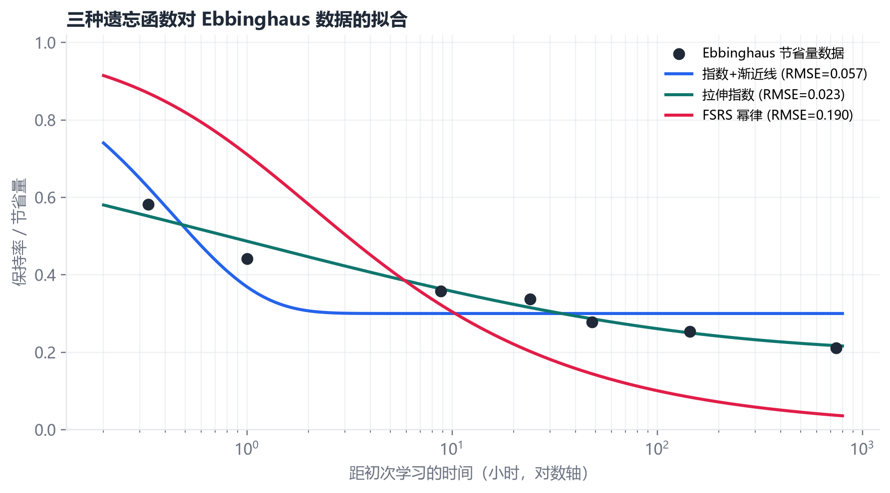
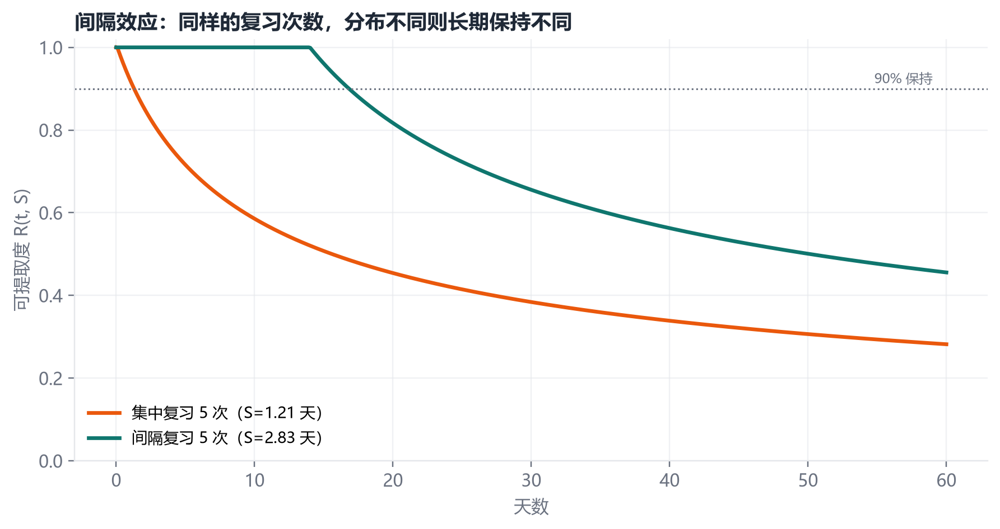
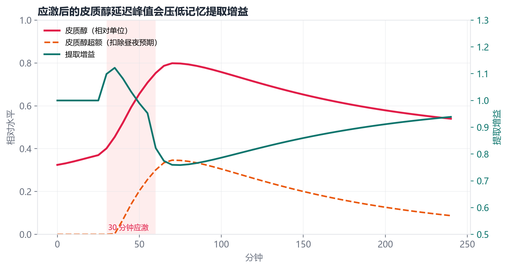
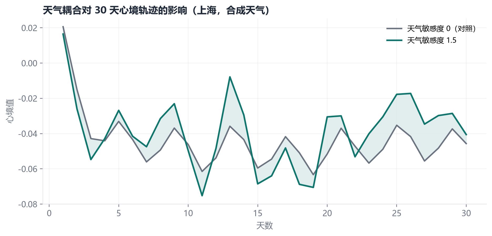
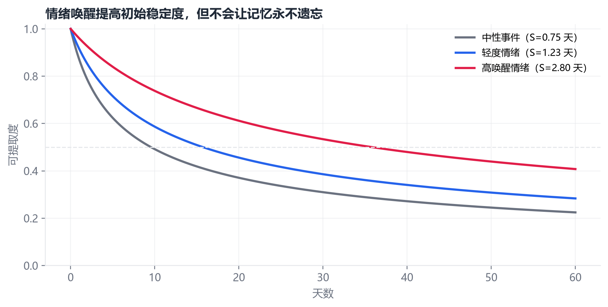

# 实验报告：五个可复现实验

> 版本：0.3.4（五个主实验自 0.1.0 起未变；附录 A 为 0.1.2 新增；0.3.1 增加口语情绪/心境本地长测，0.3.2 增加规则 vs LLM 评价探针，见 [LANGUAGE_MOOD_AUDIT.md](LANGUAGE_MOOD_AUDIT.md) 与 [LLM_APPRAISAL.md](LLM_APPRAISAL.md)）
>
> 运行：`python experiments/run_experiments.py`
>
> 本地模型长测：`python experiments/longrun_language.py --fresh --turns 30`
>
> 规则 vs LLM 评价：`python experiments/appraisal_llm_probe.py --base-url http://127.0.0.1:8080/v1`
>
> 输出：`docs/figures/*.png`、`docs/experiments.json`
>
> 环境：Windows 11，Python 3.12，NumPy / Matplotlib。所有实验使用固定时间戳与固定 seed，不依赖网络。

---

## 0. 先说清楚这些实验在测什么

这五个实验**不是**在验证“Thymos 像人一样工作”。它们测的是：

1. 实现出来的曲线/动力学是否与它所声称的数学形式一致；
2. 参数变化是否产生预期的定性方向（间隔更好、应激先升后降、天气效应有界）；
3. 系统是否可复现、可解释、可被证伪。

因此，下面每个实验都包含“结果”与“它不能证明什么”。

| # | 实验 | 主要变量 | 图 |
|---|---|---|---|
| 1 | 三种遗忘函数对 Ebbinghaus 数据的拟合 | RMSE、渐近线、时间常数 | `fig1_retention_models.png` |
| 2 | 集中复习 vs 间隔复习 | 稳定度、30 天保持率 | `fig2_spacing.png` |
| 3 | 急性应激的皮质醇延迟与提取增益 | 皮质醇、超额、retrieval_gain | `fig3_stress_memory.png` |
| 4 | 天气敏感度对 30 天心境轨迹的影响 | 心境差、温度相关 | `fig4_weather_mood.png` |
| 5 | 情绪唤醒对遗忘半衰期的影响 | 初始稳定度、半衰期 | `fig5_emotional_forgetting.png` |

---

## 1. 遗忘函数：指数、拉伸指数与 FSRS

### 1.1 方法

- 数据：Ebbinghaus（1885）节省量的 7 个时间点（20 分钟–31 天）。
- 因变量：节省量 / 100，范围 0–1。
- 模型：
  1. `R = c + (1-c) * exp(-t/τ)`，网格搜索 `c∈[0,0.30]`、`τ∈[0.1,200]` 小时；
  2. `R = c + (1-c) * exp(-(t/τ)^β)`，`β∈[0.1,0.9]`；
  3. FSRS：`R = (1 + F*t_days/S)^-0.5`，`S∈[0.01,500]` 天。
- 指标：RMSE（7 个点）。

### 1.2 结果

| 模型 | 最优参数 | RMSE |
|---|---|---:|
| 指数 + 渐近线 | c=0.30，τ=0.43 h | 0.0567 |
| 拉伸指数 | c=0.20，τ=0.88 h，β=0.20 | **0.0225** |
| FSRS 幂律 | S=0.01 天 | 0.1896 |



### 1.3 解读

- **拉伸指数拟合最好**：它同时允许“早期快速下降”和“长期厚尾”，β=0.20 表示非常强的拉伸（早期快、后期慢）。
- **简单指数**也能抓住大致形状，但渐近线被推到 0.30，短时点拟合较差。
- **FSRS 拟合最差**，原因不是实现错误，而是**构念不同**：
  - FSRS 的 `R` 是“在调度目标下的可提取概率”，没有渐近线，长期趋近 0；
  - Ebbinghaus 的“节省量”有约 20% 的长尾，且测量的是再学习收益，不是自由回忆。
  - 用 7 个点、3 个参数去拟合，容易过拟合；FSRS 只有一个自由参数 `S`，反而吃亏。
- 这个实验支持设计文档中的选择：**用 FSRS 做调度语义，但不要把它的曲线当成人类遗忘定律**。

### 1.4 它不能证明什么

- 不能说明“人类遗忘一定是拉伸指数”；7 个点、单被试、无意义音节，外部效度很低。
- 不能说明 FSRS “错误”；它只是不适合这个数据集/构念。
- 没有置信区间；RMSE 差异可能由参数数量与测量噪声驱动。

---

## 2. 间隔效应：集中 vs 间隔

### 2.1 方法

- 初始稳定度：`initial_stability(salience=0.6, valence=0.2, arousal=0.3, encoding_gain=1.0, base=0.5)`。
- 两种安排，各复习 5 次，质量 0.85：
  - **集中**：第 0、0.02、0.04、0.06、0.08 天；
  - **间隔**：第 0、1、3、7、14 天。
- 每次复习按当前 `R` 更新 `S`：
  ```text
  spacing = 0.05 + 0.95*(1 - R)
  S ← S * (1 + 1.70 * spacing * quality)
  ```
- 复习结束后，计算 0–60 天的 `R(t,S)`。

### 2.2 结果

| 指标 | 集中 | 间隔 |
|---|---:|---:|
| 最终稳定度 S | 1.214 天 | **2.827 天** |
| 30 天保持率 | 38.4% | **65.5%** |
| 稳定度比 | — | **2.33×** |



### 2.3 解读

- 同样 5 次复习，间隔安排把稳定度提高到 2.33 倍，30 天保持率高 27 个百分点。
- 机制来自更新规则：在 `R` 还很高时复习，`spacing` 小，增益小；在 `R` 降到中等时复习，增益大。这与“desirable difficulty”一致。
- 这是**模型内部的自洽性检验**：它证明实现确实会产生间隔效应，而不是把结果写死。

### 2.4 它不能证明什么

- **循环性**：更新规则本身就是为了产生间隔效应而设计的；这个实验不能被当作“间隔效应存在”的独立证据。间隔效应的独立证据见 Cepeda et al. (2006) 等。
- 没有模拟“集中复习的短期优势”；现实中集中复习可能在考试前一天更有效。
- 质量固定为 0.85，没有模拟失败、疲劳、动机。

---

## 3. 急性应激：皮质醇延迟峰值与提取增益

### 3.1 方法

- 使用 `EndocrineSystem`，固定昼夜相位 10:00。
- 0–30 分钟：无应激；30–60 分钟：`stress=1.0`；60–240 分钟：`stress=0`。
- 以 5 分钟为步长，记录：
  - 原始皮质醇；
  - `cortisol_excess`（扣除昼夜预期）；
  - `retrieval_gain`。
- 另计算中性 vs 高唤醒情绪记忆的初始稳定度。

### 3.2 结果

| 指标 | 数值 |
|---|---:|
| 皮质醇峰值 | 0.799 |
| 峰值时刻 | 应激开始后 **70 分钟** |
| 最低提取增益 | **0.759** |
| 中性记忆 S0 | 0.748 天 |
| 高唤醒情绪记忆 S0 | 2.805 天 |
| 情绪记忆优势 | **3.75×** |



### 3.3 解读

- 皮质醇不是瞬时变量：应激开始 30 分钟后仍在上升，峰值出现在 70 分钟；这符合 HPA 级联的延迟。
- `cortisol_excess` 在应激前接近 0，说明昼夜预期被正确扣除；应激后上升，提取增益下降。
- 提取增益最低 0.759，意味着在高应激下，同样的线索只能恢复约 76% 的可用性；这是**中等偏强**的效应，符合“应激损害提取”的方向。
- 情绪记忆的 S0 是中性记忆的 3.75 倍，说明情绪唤醒会显著延长初始稳定度，但不是永久。

### 3.4 它不能证明什么

- 效应大小由参数（`retrieval_cortisol_penalty=0.70`、HPA 增益）决定，没有用真实被试数据拟合。
- 没有区分编码时应激 vs 提取时应激；真实研究里时间点决定方向。
- 没有性别、口服避孕药、慢性应激、睡眠等调节变量。
- 0.759 的提取增益不应被引用为“人类在压力下只能记住 76%”。

---

## 4. 天气耦合：30 天心境轨迹

### 4.1 方法

- 同一画像（上海，31.23°N），同一 seed，同一事件脚本：
  - 每 4 天一次正面工作事件；
  - 每 4 天一次轻度负向事件；
  - 每天推进 24 小时。
- 两个条件：
  - 对照：`weather_sensitivity=0`；
  - 敏感：`weather_sensitivity=1.5`。
- 使用离线合成天气（确定性），记录每日心境、温度、天气桶。

### 4.2 结果

| 指标 | 数值 |
|---|---:|
| 平均绝对心境差 | **0.0119** |
| 最大绝对心境差 | **0.0280** |
| 与温度的相关系数 | 0.208 |
| 雨天天数 | 4 / 30 |
| 最终心境（对照） | -0.046 |
| 最终心境（敏感） | -0.041 |



### 4.3 解读

- 即使把敏感度调到 1.5，天气对心境的平均影响也只有 **0.012**，最大 0.028；这符合文献中“平均效应很小、个体差异大”的结论。
- 两条轨迹形状高度相似，说明事件与内分泌动力学主导，天气只是小偏置；这是刻意的设计选择。
- 相关系数 0.208 不是“温度导致心境”，只是同步变化；合成天气与事件脚本可能偶然同相。
- 效应有界（±0.12），确保任何单一因素都不能“决定”心境。

### 4.4 它不能证明什么

- 合成天气不是实测天气；不能外推到真实上海。
- 没有真实用户；敏感度 1.5 是人为设定。
- 没有控制事件与天气的交互；真实生活中，天气会影响活动选择，从而间接影响情绪。
- 30 天太短，无法评估季节效应。

---

## 5. 情绪唤醒与遗忘半衰期

### 5.1 方法

- 三组初始条件：
  - 中性：`salience=0.4, valence=0.0, arousal=0.1, encoding_gain=1.0`；
  - 轻度：`salience=0.6, valence=0.5, arousal=0.5, encoding_gain=1.1`；
  - 高唤醒：`salience=0.8, valence=0.9, arousal=0.85, encoding_gain=1.6`。
- 计算 `S0`，画 0–60 天 `R(t,S0)`，并用二分法求 `R=0.5` 的时间。

### 5.2 结果

| 组 | S0（天） | 半衰期（天） |
|---|---:|---:|
| 中性 | 0.75 | **9.56** |
| 轻度情绪 | 1.23 | **15.75** |
| 高唤醒情绪 | 2.80 | **35.87** |



### 5.3 解读

- 情绪唤醒把初始稳定度提高约 3.7 倍，把半衰期从 9.6 天延长到 35.9 天。
- 但高唤醒记忆仍会遗忘：60 天时可提取度约 0.40，不是“永不忘记”。
- 这符合“情绪增强记忆但非永久”的总体方向；具体倍数由参数决定。

### 5.4 它不能证明什么

- 没有真实情绪诱发；`valence/arousal` 是输入参数，不是测量。
- 半衰期是模型内部量，不是人类被试的实测半衰期。
- 没有区分正/负效价、唤醒度、复述、睡眠等调节因素。

---

## 6. 复现与数据

### 6.1 命令

```bash
python experiments/run_experiments.py
```

### 6.2 输出

- `docs/figures/fig1_retention_models.png`
- `docs/figures/fig2_spacing.png`
- `docs/figures/fig3_stress_memory.png`
- `docs/figures/fig4_weather_mood.png`
- `docs/figures/fig5_emotional_forgetting.png`
- `docs/experiments.json`

### 6.3 确定性

- 所有实验使用固定时间戳（`2026-03-01` 等）与固定 seed。
- 天气使用 `offline=True` 的合成数据，由经纬度与日期哈希派生。
- 没有网络、没有随机采样；同一环境下结果应逐位一致（浮点除外）。

---

## 7. 有效性威胁

| 类型 | 威胁 | 缓解 |
|---|---|---|
| 构念效度 | “情绪”“激素”是相对量，不是生理测量 | 全文标注相对单位；不用于诊断 |
| 内部效度 | 间隔实验的更新规则本身产生间隔效应（循环） | 明确说明这是实现一致性检验，不是独立证据 |
| 外部效度 | 合成天气、单一时区、无真实用户 | 提供在线天气模式；未来做用户研究 |
| 统计效度 | 没有置信区间、没有重复试验、参数多 | 固定 seed；报告完整参数；未来做敏感性分析 |
| 研究者自由度 | 参数可手调，容易“调出”好看结果 | 参数表公开；实验脚本固定；鼓励第三方重跑/反驳 |
| 生态效度 | 事件是短文本，不是真实多模态经历 | 未来接入对话/日记/传感器 |

---

## 8. 下一步实验

1. **参数恢复（parameter recovery）**：用已知参数生成数据，再拟合，检查能否恢复；不能恢复的参数说明不可识别。
2. **消融**：去掉内分泌、去掉天气、去掉再巩固、去掉 ACT-R，比较行为差异。
3. **敏感性分析**：Sobol/Morris，找出对输出影响最大的 5 个参数。
4. **真实日志拟合**：用 Anki/复习日志拟合 `S0` 与 `spacing`，而不是手调。
5. **用户研究**：让被试记录 2–4 周的事件、情绪、睡眠、天气，比较模型预测与自评；必须过伦理审查。
6. **对抗测试**：构造矛盾/反讽/混合情绪文本，测量评价层的失败率。
7. **长期稳定性**：模拟 1 年，检查数值漂移、状态爆炸、性能。

---

## 9. 一句话总结

> 这些实验证明 Thymos **按设计工作**，而不是证明它**理解人类**。前者是工程，后者需要用户研究与独立验证。

---

## 附录 A：中文 embedding 检索基线

这是一个独立的 12 条中文小基准，只按余弦相似度排序，**不经过** Thymos 的激活、心境和关联扩散，因此它测的是 embedding 本身，不是完整检索器。

```bash
python experiments/retrieval_benchmark.py --embedding hash
# 有 Ollama 时：
ollama pull bge-m3
python experiments/retrieval_benchmark.py --embedding ollama --model bge-m3
```

当前零依赖哈希基线：

| 指标 | 值 |
|---|---:|
| recall@1 | 0.417 |
| recall@3 | 0.750 |
| recall@5 | 0.750 |
| MRR | 0.572 |

失败的典型是 `coffee`（“平时喝什么咖啡” vs “冰美式”）、`work`（“工作上的事” vs “项目评审”）和 `peanut`（“坚果” vs “花生”）：没有共享字符，哈希 n-gram 无法建立同义关系。这正是 `--embedding ollama --embedding-model bge-m3` 要解决的问题；换 embedding 后请用同一脚本重跑，而不是凭感觉判断。
