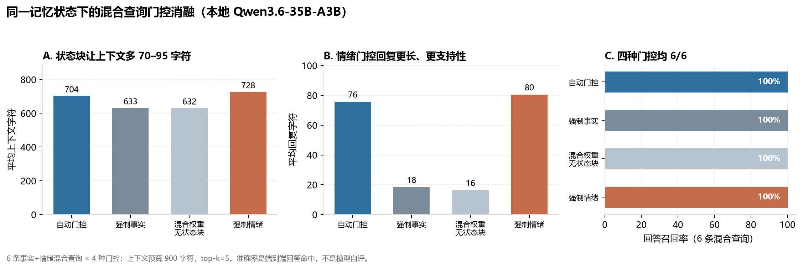

# 本地 35B 混合查询长测与门控消融

> 测试日期：2026-11-13  
> 模型：本地 `llama-server`，`Qwen3.6-35B-A3B-Q4_K_M`  
> 状态：`Thymos 0.3.0` 控制平面，离线环境，900 字符上下文预算，`top_k=5`

## 结论先说

这次重点只有一个：**“事实 + 情绪”混合查询，会不会被情绪门控误伤事实召回？**

在这组 65 轮连续对话、27 条探针里，没有观察到误伤：

- 27 条探针的上下文召回 **27/27 = 100%**，回答召回 **27/27 = 100%**。
- 其中意图判定为 `mixed` 的 8 条，上下文和回答都是 **8/8**，旧信息误用 **0**。
- 同一份记忆状态下，6 条混合查询 × 4 种门控（自动、强制事实、混合权重但无状态块、强制情绪）共 24 次调用，**24/24 回答正确，0 条旧信息误用**。
- 门控的真实代价不是“答错事实”，而是**上下文多 70–95 字符**，以及情绪模式下回复更长、更支持性；延迟差异主要来自回复长度，而不是检索失败。



## 测试设置

| 项目 | 设置 |
|---|---|
| 模型 | `Qwen3.6-35B-A3B-Q4_K_M`，本地 `llama-server` |
| 接口 | `http://127.0.0.1:8080/v1`（OpenAI 兼容） |
| 对话轮数 | 65 轮，脚本化多会话剧情 |
| 探针数 | 27 条（事实、更新、旧信息、混合意图） |
| 上下文预算 | 900 字符，`top_k=5` |
| 生成参数 | `max_tokens=220`，`temperature=0.7`（长测）/ `0.2`（消融） |
| 状态 | 每轮保存；探针轮不写入长期记忆 |
| 评分 | 规则命中：必须出现全部关键事实；出现禁用旧事实即记为旧信息误用 |

长测脚本：`experiments/longrun_local.py`  
启动器：`experiments/run_local_50.py`  
门控消融：`experiments/gate_ablation.py`

## 65 轮连续对话

### 总体指标

| 指标 | 结果 |
|---|---:|
| 轮数 | 65 |
| 探针数 | 27 |
| 上下文召回率 | 1.000 |
| 回答召回率 | 1.000 |
| 混合意图探针 | 8 |
| 混合意图上下文召回 | 1.000 |
| 混合意图回答召回 | 1.000 |
| 混合意图旧信息误用 | 0 |
| 纯事实意图探针 | 17 |
| 纯事实意图上下文召回 | 1.000 |
| 纯事实意图回答召回 | 1.000 |
| 旧信息误用总数 | 0 |
| 模型错误 | 0 |
| 平均延迟 | 6.05 s |
| P95 延迟 | 7.91 s |
| 总墙钟时间 | 6.6 min |
| 心境起点 → 终点 | +0.06 → −0.04 |
| 皮质醇范围 | 0.34–0.65 |

### 8 条 `mixed` 意图探针

| 轮 | 查询 | 门控 | 上下文 | 回答 |
|---:|---|---:|---|---|
| 10 | 我的猫叫什么？是什么品种？ | 0.15 / 状态开 | ✓ | ✓ |
| 13 | 最近客户改需求有点烦，你还记得我对什么过敏吗？ | 0.15 / 状态开 | ✓ | ✓ |
| 24 | 我喝咖啡加糖吗？ | 0.15 / 状态开 | ✓ | ✓ |
| 31 | 搬家后一直很累，我现在的收货地址是哪里？ | 0.15 / 状态开 | ✓ | ✓ |
| 37 | 最近睡得晚有点焦虑，我现在一般几点睡？ | 0.15 / 状态开 | ✓ | ✓ |
| 56 | 我喝咖啡的习惯是什么？ | 0.15 / 状态开 | ✓ | ✓ |
| 58 | 最近工作压力有点大，你还记得我的猫叫什么吗？ | 0.15 / 状态开 | ✓ | ✓ |
| 65 | 总结一下你记得的关于我的事。 | 0.15 / 状态开 | ✓ | ✓ |

几个代表性回答：

- 第 13 轮：`记得，你对花生和芒果过敏。……`
- 第 31 轮：`你现在的收货地址是上海市徐汇区。`
- 第 37 轮：`记得你从 3 月 10 日起，入睡时间都是在十二点之后。`
- 第 58 轮：`记得的，你的猫叫豆豆，是一只可爱的橘猫。`
- 第 65 轮：同时命中姓名、城市、宠物、项目、过敏五项。

## 四门控消融

同一份记忆状态、同一组 6 条混合查询，只改门控参数，不更新记忆：

| 门控 | 含义 | 上下文召回 | 回答召回 | 旧信息误用 | 平均上下文字符 | 平均回复字符 | 平均延迟 |
|---|---|---:|---:|---:|---:|---:|---:|
| 自动门控 | 实际查询级策略 | 6/6 | 6/6 | 0 | 704.5 | 75.7 | 7.04 s |
| 强制事实 | mood=0，无状态块 | 6/6 | 6/6 | 0 | 633.2 | 18.3 | 4.89 s |
| 混合权重、无状态块 | mood=0.15，无状态块 | 6/6 | 6/6 | 0 | 632.5 | 16.3 | 4.87 s |
| 强制情绪 | mood=0.35，有状态块 | 6/6 | 6/6 | 0 | 728.2 | 80.5 | 6.27 s |

读法：

1. **准确率没有差异。** 四种门控都是 6/6，且没有把旧地址、旧作息、旧咖啡习惯翻出来。
2. **上下文长度有差异。** 状态块让上下文从约 633 字符增加到 704–728 字符；在 900 字符预算下，事实块仍然完整，没有被挤掉。
3. **回复长度差异更大。** 自动/强制情绪平均回复 76–80 字符，强制事实只有 16–18 字符；延迟差异主要是生成更长的支持性回复，而不是检索变慢。
4. **自动门控并不总是 `mixed`。** 例如“想起搬家前在杭州的日子……”被历史意图拦截，mood=0、状态关闭；“最近心情不太好，我喝咖啡加糖吗？”被情绪意图拦截，mood=0.35、状态打开；两种情况下事实仍然正确。这说明门控是查询级的，不是全局开关。

## 第一次运行发现并修复的真实缺陷

第一次 65 轮运行的结果是混合上下文/回答各 7/8，唯一失败的是“我喝咖啡的习惯是什么？”——它回答“喜欢加糖”，而正确事实是“不加糖”。

根因不在门控，而在测试与产品边界：

- 长测为了保留所有剧情，调用了 `memory.observe(..., min_importance=0.0)`；
- 这会把探针问句也写进记忆；
- 问句“我喝咖啡加糖吗？”被规则抽取成事实 `咖啡糖=加糖`；
- 问句“我是不是独立开发者？”被抽取成 `职业=不是独立开发者`；
- 后续混合查询读到的是被污染的事实层，于是答错。

修复分两层：

1. **测试层**：探针轮不再写入长期记忆（`experiments/longrun_local.py`）。
2. **产品层**：即使宿主用 `min_importance=0` 保留问句，`AgentMemory.observe` 也不会从问句学习结构化事实；新增回归测试 `test_forced_question_storage_does_not_poison_facts`。

修复后重跑，27/27、8/8、24/24 全部通过。

## 这组结果能说明什么、不能说明什么

**能说明：**

- 在当前 900 字符预算、当前规则抽取器和本地 35B 模型下，混合查询的情绪门控没有挤掉事实块，也没有造成旧信息误用。
- 门控的可见成本是上下文长度和回复风格，不是事实准确率。
- 事实层被问句污染时，症状会伪装成“门控误伤”；必须先保证写入路径干净，再谈门控效果。

**不能说明：**

- 不能外推到所有混合查询。只有 6 条消融查询、8 条长测混合探针，且都是脚本化表达，存在明显天花板效应。
- 不能证明 600 字符或更小预算下仍不误伤；事实块虽然优先，但预算更紧时可能截断情景记忆。
- 不能证明换一个模型、换一种事实抽取器仍成立。规则抽取器对“习惯”“加糖吗”这类表达仍可能漏抽或错抽。
- 延迟数字不是纯检索开销；情绪模式回复更长，端到端延迟自然更高。

## 下一步建议

1. **扩查询集**：把每条混合查询改写成 5–10 种口语/省略/指代变体，尤其是“习惯”“最近”“还记得”这类弱事实线索。
2. **压预算**：在 600、450、300 字符下重复四门控消融，观察事实块被截断的临界点。
3. **换抽取器**：用 `LLMFactExtractor` 或规则+LLM 混合抽取，比较问句、否定、纠正、多值场景的事实错误率。
4. **换模型**：至少加一个 7B–14B 小模型，验证门控结论是否依赖 35B 的指令遵循能力。
5. **真实案例**：用客服/陪伴场景的脱敏多会话日志替代合成脚本，按 `docs/EVALUATION.md` 的预注册指标跑。

## 复现

```powershell
# 65 轮长测（会自动启动本地模型，结束后停止）
.\.venv\Scripts\python.exe -X utf8 experiments\run_local_50.py `
  --exe .\llama.cpp\llama-server.exe `
  --model .\models\Qwen3.6-35B-A3B-Q4_K_M.gguf `
  --turns 65 --max-tokens 220 --temperature 0.7 --top-k 5 --max-chars 900

# 同一状态的六查询 × 四门控消融
.\.venv\Scripts\python.exe -X utf8 experiments\run_local_50.py `
  --exe .\llama.cpp\llama-server.exe `
  --model .\models\Qwen3.6-35B-A3B-Q4_K_M.gguf `
  --script experiments\gate_ablation.py `
  --script-args "--max-chars 900 --max-tokens 220 --temperature 0.2"
```

结果文件：

- 长测：`.work/longrun/report.json`、`.work/longrun/report.md`
- 消融：`.work/longrun/gate_ablation.json`、`.work/longrun/gate_ablation.md`
- 图：`docs/figures/fig7_mixed_gate.png`

## 一句话

**这次没有看到“情绪门控把事实挤掉”；看到的是“问句污染事实层”会伪装成门控失败。修掉写入路径后，混合查询在这组测试里是 100% 命中的，代价主要是上下文长度和更长的情绪化回复。**
