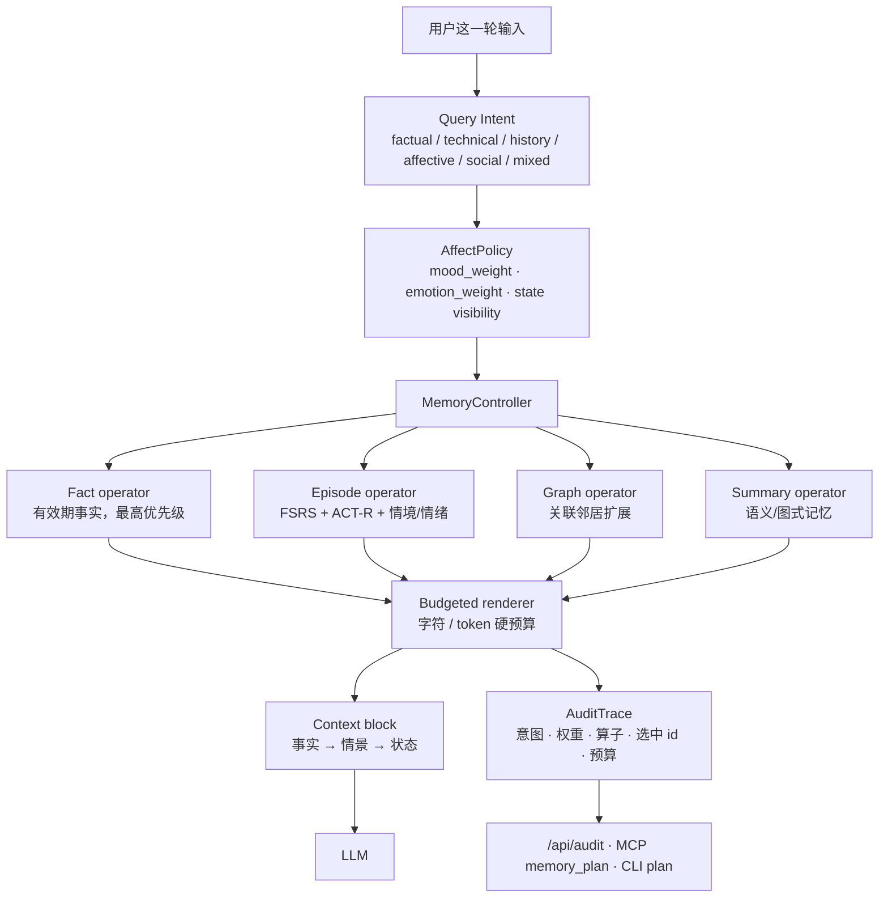

# Thymos 0.3：从记忆引擎到记忆控制平面

> 一句话：Thymos 不试图再做一个更大的向量库，而是做 LLM Agent 与任意记忆数据平面之间的
> **表示路由、情绪路由、预算路由和审计层**。数据平面可以换，控制平面留下。

这份文档是 0.3.0 的产品定义，也是“保留 / 改写 / 放弃 / 冻结”的执行清单。它回答三个问题：

1. 我们到底卖什么、不卖什么；
2. 别人的项目已经做了什么，我们借什么、不重复什么；
3. 下一阶段用什么指标判断产品是否成立。

---

## 1. 产品边界

### 1.1 目标用户

- 做陪伴型 Bot、客服 Bot、个人 Agent 的独立开发者和小团队；
- 已经有 LLM、向量库或记忆服务，但回答“记得但不自然”“情绪不连续”“上下文一满就丢事实”的团队；
- 需要本地优先、可审计、不能把用户隐私交给第三方记忆云的产品。

### 1.2 我们提供的四件事

| 层 | 能力 | 0.3.0 的实现 |
|---|---|---|
| 表示路由 | 事实、情景、图式摘要、关联邻居，按查询选择表示 | `MemoryController` + 四个算子 |
| 情绪路由 | 事实问题关闭心境一致性；支持型问题才允许情绪参与 | `classify_intent` + `AffectPolicy` |
| 预算路由 | 在字符/token 硬预算内决定先放什么、后放什么 | `render_context` + `trim_to_tokens` |
| 审计 | 每次回答前能解释“用了什么、为什么、丢掉了什么” | `AuditTrace` + `/api/audit` + MCP `memory_plan` |

### 1.3 我们不做什么

- 不做通用向量数据库、不追求十亿级向量检索；
- 不做 Agent 框架、不绑定某个模型或云厂商；
- 不声称模拟真实神经内分泌，所有激素量都是相对单位；
- 不用情绪做操控、成瘾或付费转化优化；情绪只用于语气连续性和记忆显著性；
- 不把“记忆”当成不可删除的日志：用户必须能纠正、删除、导出。

---

## 2. 保留 / 改写 / 放弃 / 冻结

### 2.1 保留（继续投入）

| 资产 | 理由 | 0.3.0 动作 |
|---|---|---|
| FSRS 式遗忘曲线与稳定度更新 | 这是“深浅”而非“存不存”的核心，已有可复现实验 | 不动公式，只作为 episode 算子的排序基础 |
| OCC 评价 → PAD 情绪 → 快慢心境 | 情绪不是标签，而是有半衰期和整合过程 | 不动动力学，只增加查询级门控 |
| 八变量内分泌层与环境耦合 | 这是与普通 RAG 记忆的差异点，也是可解释实验的载体 | 不动方程，保留离线合成天气 |
| 事实库的有效期/冲突处理 | 事实错误比情绪错误更伤产品 | 保留，并作为 fact 算子第一优先级 |
| 本地优先、零运行时依赖、确定性种子 | 可复现、可审计、可离线 | 保留 |
| 安全边界与不可信记忆标记 | 记忆是用户输入，不是系统指令 | 保留，所有上下文继续带 `<memory trust="untrusted">` |

### 2.2 改写（0.3.0 的主工作）

| 旧形态 | 新形态 | 代码 |
|---|---|---|
| `render_context` 直接检索 + 渲染 | 先计划、再检索、再渲染、最后审计 | `src/thymos/control.py` |
| 全局固定的心境一致性权重 | 按查询意图选择 0 / 0.15 / 0.35 | `src/thymos/policy.py` |
| 只有事实 + 情景两种表示 | 增加图邻居与图式摘要算子 | `MemoryController._expand_graph` / `_summary_hits` |
| 记忆库写死 `MemoryStore` | 可插拔 `MemoryBackend` 协议 | `src/thymos/backends.py` |
| 只给最终上下文，不解释 | `AuditTrace` + `/api/context` + MCP `memory_plan` | `api.py`, `mcp_server.py` |
| 对外是“情绪记忆引擎” | 对外是“Agent 的记忆控制平面，带一个动力学内核” | README / 本文 |

### 2.3 放弃（不再作为产品主张）

| 放弃的主张 | 原因 | 保留的部分 |
|---|---|---|
| “做一个更好的通用记忆库” | Mem0、Graphiti、Letta、MemOS 已在数据平面和生态上领先，正面竞争没有胜算 | 通过 `MemoryBackend` 适配它们，而不是替换它们 |
| “情绪变量越多越像人” | 增加变量不等于增加产品价值，且不可验证 | 保留八变量作为可解释实验内核，不继续堆变量 |
| “情绪可以直接提升付费/留存” | 伦理风险高，且短期指标会诱导操控 | 只做语气连续性、记忆显著性和用户可控的陪伴体验 |
| “用一个总分衡量记忆好坏” | 记忆是任务相关的；事实、陪伴、客服的指标不同 | 用任务级指标和分层指标，见 `docs/EVALUATION.md` |

### 2.4 冻结（保留代码，不再扩展）

| 冻结项 | 状态 | 解冻条件 |
|---|---|---|
| 更多内分泌变量、更多情绪类别 | 冻结 | 有外部标注数据证明增量价值 |
| 纯哈希 n-gram 嵌入的继续调参 | 冻结 | 仅作为零依赖 fallback；主路径用 Ollama/OpenAI embedding |
| 单机 JSON 状态作为多租户后端 | 冻结 | 只用于个人 Bot；多租户走 SQLite/外部 backend |
| 复杂图算法（PPR、社区发现） | 冻结 | 先证明图算子比 top-k 有稳定增益 |
| 自建 Agent 运行时 | 冻结 | 不进入；通过 MCP/API 接入现有 Agent |

> “冻结”不是删除。代码仍可用、测试仍覆盖；只是不再投入产品资源，避免路线图失焦。

---

## 3. 运行时架构



### 3.1 一次请求的生命周期

1. **分类**：规则先判断是否是历史、技术、事实、情绪或混合问题；
2. **门控**：事实/技术问题把 `mood_weight` 设为 0，并且不暴露“当前模拟状态”；支持型问题保留情绪通道；
3. **事实优先**：`FactStore.render` 先给出当前有效事实，旧值只在历史问题中出现；
4. **情景召回**：`engine.recall` 用查询级权重计算 FSRS 可提取度、ACT-R 激活、情境匹配和情绪一致性；
5. **图扩展**：从 top hits 沿关联边取少量邻居，补回“没被直接提到但相关”的事件；
6. **摘要**：历史/情绪/混合问题加入语义图式；事实问题不强行加摘要；
7. **渲染**：在硬预算内先事实、再情景、最后状态；超预算时按优先级截断；
8. **审计**：记录 `intent`、`affect`、每个算子的候选/选中/字符数、`selected_ids`、预算和耗时；
9. **持久化**：`last_audit` 随状态保存，可通过 API/MCP 读取。

### 3.2 与 LLM 的分工

- **LLM 负责**：理解用户、决定怎么回答、在需要时调用工具、把上下文说得自然；
- **Thymos 负责**：记住什么、忘到什么程度、这次该不该让情绪影响召回、在预算内先给什么、为什么这样选；
- **LLM 可选负责**：把用户话语抽取成结构化事实（`LLMFactExtractor`），但规则抽取仍是零依赖默认路径。

这意味着：即使本地模型只有 4k/8k 上下文，控制平面也能用“事实 + 少量高价值情景 + 审计”维持连续性，
而不是把整段历史塞回 prompt。

**写路径的边界：** 0.3.0 的“准入”仍由 `AgentMemory.observe()` / `engine.perceive()` 的规则完成，
还没有独立的 `AdmissionController` 模块，也没有跨会话去重策略。读路径已经先跑通；写路径的
“什么值得记、合并到哪条、何时遗忘”是 0.3.x 的下一项，不应被 README 的“控制平面”误读为已全部完成。

---

## 4. 与同类项目：借什么、不重复什么

> 这里只做产品级比较，不评价项目优劣。星数和功能会变化，结论以“是否解决同一层问题”为准。
> 更完整的调研证据见 [STRATEGY.md](STRATEGY.md)。

| 项目 | 它最强的地方 | 我们借什么 | 我们不重复什么 / 我们的差异 |
|---|---|---|---|
| **Mem0** | 低门槛 API、托管/开源自托管、多级记忆 | 对外 API 的 ergonomics；`MemoryBackend` 适配思路 | 不做通用记忆云；我们做查询级情绪门控、预算规划和审计 |
| **Graphiti** | 时序知识图、事实有效期、增量更新 | 事实 `valid_from/valid_to` 的时间语义 | 不要求 Neo4j；我们保留轻量事实库，图只做局部扩展 |
| **Letta** | 有状态 Agent、memory blocks、sleep-time consolidation | “块”与“巩固”作为一等 citizen | 不做 Agent 运行时；我们通过 MCP/API 嵌进别人的 Agent |
| **MemOS** | 记忆操作系统、异步调度、KV-cache 视角 | “记忆是需要调度的系统资源”这一框架 | 不做完整 OS；我们只做控制平面与可审计路由 |
| **MemoryBank** | Ebbinghaus 遗忘曲线 + 陪伴型对话 | 遗忘曲线产品化、陪伴场景评测 | 不把遗忘做成单一公式；加入内分泌、环境、事实有效期与审计 |
| **A-MEM** | Zettelkasten 式笔记演化、动态链接 | 图邻居/关联扩展算子 | 不依赖 LLM 生成笔记；先做确定性链接与 top-k 扩展 |
| **HippoRAG** | 海马体索引、图上的个性化 PageRank | 图作为长期记忆索引的方向 | 0.3.0 只做局部邻居，不引入复杂图算法；先验证增益 |
| **emotional-memory** | affect-aware episodic memory、预注册评测、负结果 | 评测纪律：先写指标再跑；保留失败结果 | 我们多一层内分泌/环境动力学与控制平面；但外部效度仍需补 |
| **OpenFeelz** | 轻量 PAD/OCEAN 情绪状态 | 评价→PAD 的紧凑映射 | 我们把它接到记忆生命周期与事实层，而不是只做情绪状态 |
| **YourMemory** | 巩固、审计、反 benchmark 过拟合的讨论 | 审计轨迹、失败案例意识 | 我们保留情绪/内分泌层；不声称通用记忆第一 |

### 4.1 我们的真实差异（一句话版本）

> 别人优化“把什么放进上下文”，我们优化“**这一次该不该让情绪参与、先放哪种记忆、为什么这样选、丢了什么**”。

这不是“更强”，而是“不同层”。如果用户只需要最大召回率，Mem0/Graphiti 更合适；如果用户需要
陪伴连续性、事实可靠性和可解释性同时存在，Thymos 的控制平面才有位置。

### 4.2 必须补的短板

1. **外部效度**：目前只有合成案例、自建 held-out 和本地模型 50 轮；需要在 LongMemEval/LoCoMo
   或真实客服/陪伴数据上跑强基线。
2. **中文召回**：哈希嵌入只是 fallback；主路径要接 bge-m3 / Ollama embedding，并报告
   Recall@k、MRR、事实冲突率。
3. **参数校准**：`mood_weight` 的 0/0.15/0.35 是产品默认值，不是实验拟合值；需要做敏感性分析。
4. **多租户与并发**：当前 SQLite/JSON 适合个人 Bot；多租户需要 backend 适配与隔离。
5. **安全与合规**：记忆删除、导出、保留期、PII 脱敏已有基础，但还需要审计日志保留策略和用户同意流程。

---

## 5. 怎么用（0.3.0）

### 5.1 Python：计划 + 上下文

```python
from thymos import AgentMemory, Profile, ThymosConfig

memory = AgentMemory(
    ".thymos/companion.json",
    profile=Profile(name="林墨", location_name="杭州"),
    config=ThymosConfig(offline=True, seed=7),
)

memory.observe("我叫林墨，对花生过敏。", min_importance=0)
memory.observe("最近工作压力很大，有点焦虑。", min_importance=0)

plan = memory.plan("我叫什么？", max_chars=600)
print(plan["intent"]["label"])          # factual
print(plan["affect"]["mood_weight"])    # 0.0
print(plan["context"])                  # 给 LLM 的上下文块
print(plan["operators"])                # 四个算子的审计

# 只取上下文，不关心审计
context = memory.context("最近压力很大，陪我聊聊", max_chars=600)
```

### 5.2 CLI

```bash
python -m thymos --state .thymos/demo.json --offline plan "我叫什么？" --max-chars 600
python -m thymos --state .thymos/demo.json --offline plan "最近压力很大" --json
```

### 5.3 HTTP

```bash
python -m thymos --offline serve
curl -X POST http://127.0.0.1:8787/api/context \
  -H "Content-Type: application/json" \
  -d '{"query":"我叫什么？","max_chars":600}'
```

返回 `context` 与 `plan`；`GET /api/audit` 返回最近一次审计。非 loopback 部署请设置
`THYMOS_API_TOKEN`。

### 5.4 MCP

MCP server 现在提供七个工具，新增 `memory_plan`：

```json
{"name":"memory_plan","arguments":{"user_text":"我叫什么？","max_chars":600}}
```

宿主 Agent 可以先用 `memory_plan` 看路由与预算，再用 `memory_context` 取最终上下文；调试时
直接读审计，而不是猜“为什么它没记住”。

### 5.5 审计 JSON 长什么样

```json
{
  "query": "我叫什么？",
  "intent": {"label": "factual", "confidence": 0.7, "reasons": ["factual x1"]},
  "affect": {"mood_weight": 0.0, "emotion_weight": 0.05, "include_state": false,
             "reason": "facts first; mood congruence disabled"},
  "operators": [
    {"name": "fact_lookup", "status": "used", "selected": 3},
    {"name": "episode_recall", "status": "used", "selected": 4},
    {"name": "graph_traversal", "status": "empty", "selected": 0},
    {"name": "summary", "status": "empty", "selected": 0}
  ],
  "selected_ids": ["..."],
  "budget": {"chars": 600, "tokens": null},
  "chars": 252,
  "tokens": 144
}
```

---

## 6. 成功标准（90 天）

### 6.1 产品指标

| 指标 | 基线 | 90 天目标 | 测法 |
|---|---|---|---|
| 事实级准确率 | 自建 held-out 已有基线 | ≥ 90%，且不低于 RAG 强基线 | 固定案例、盲评、按事实冲突计分 |
| 事实冲突率 | 需补测 | ≤ 3% | 旧值出现在当前事实中的比例 |
| 陪伴连续性偏好 | 需补测 | 相对无记忆基线 ≥ 60% 胜率 | 双盲 A/B，50 轮以上 |
| 上下文预算合规 | 当前 100% 硬约束 | 100% 不超字符/token | 自动检查 |
| 审计可解释性 | 新增 | 100% 的计划有 `selected_ids` 与算子报告 | API 自动检查 |
| 删除/纠正可验证 | 已有事实删除 | 用户可在一次操作内删除并验证 | 端到端测试 |

### 6.2 工程指标

- 完整测试 ≥ 130 项，CI 绿；
- 零运行时依赖路径保持可用；
- SQLite backend 并发读、单写可用；
- 本地 8k 上下文模型连续 50 轮不崩、不丢事实；
- API/MCP 均有最小接入示例与失败案例。

### 6.3 研究指标

- 在 LongMemEval 或 LoCoMo 上跑通至少一个强基线对照；
- 报告负结果：情绪门控在哪些问题上无效、哪些参数不敏感；
- 预注册指标后再跑，不做事后挑指标。

---

## 7. 下一步（按优先级）

1. **P0（两周）**：外部 benchmark 适配 + 强基线；把 `mood_weight` 做敏感性实验；
2. **P1（一个月）**：Mem0/Graphiti 的 `MemoryBackend` 参考适配器；多租户 SQLite；
3. **P2（三个月）**：陪伴/客服真实案例回放；审计 UI；删除/导出合规流程；
4. **冻结项**：不扩情绪变量、不做通用记忆库、不做 Agent 运行时。

---

## 8. 一句话总结

> **保留动力学内核，改写外层为控制平面，放弃“更大记忆库”的正面竞争，冻结无法验证的变量扩张。**
>
> 我们要做的不是“又一个记忆系统”，而是让任何记忆系统在情绪、预算和审计上变得可用。
