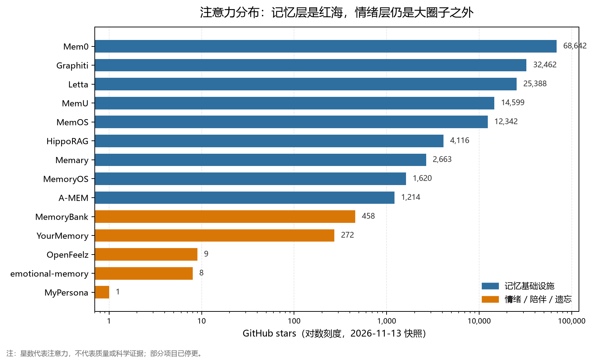

# 目标校准与同类项目调研：从“能运行”到“能证伪”

> 调研日期：2026-11-13  
> 调研范围：GitHub 公开仓库、论文摘要与项目 README；星数为当日快照，只代表流行度，不代表质量。  
> 一句话结论：**这一轮 P0–P2 可靠性升级没有定错，但它们是“工程可信度”目标，不是“科学主张”。真正的问题不是目标太谦虚，而是层级错位——我们把“能发布”当成了“已证明”。下一步不该再加情绪变量，而该把科学验证拉回主线：用消融、纵向基准和下游结果，证明这套耦合在什么条件下有用、在什么条件下有害。**

> **实现注记（2026-11-13）：** 0.3.0 已把 4.6 的“读路径控制平面”落成代码——查询意图、情绪门控、四算子、预算与审计；写路径准入、外部 benchmark 和下游验证仍未完成。产品取舍见 [PRODUCT.md](PRODUCT.md)，不足见 [GAPS.md](GAPS.md)。

---

## 0. 结论先行

是的，目标需要更深。但“深”不是把 8 个激素扩成 12 个，也不是把面板做得更像人；**“深”是让主张更难被推翻，并且敢写清楚失败条件**。一个更深的 Thymos，不应该说“我们也有情绪记忆”，而应该能回答：

1. **预测**：给定当前心境、内分泌状态和环境，能否预测下一次会想起什么、心境会怎么走？
2. **归因**：这些预测里，有多少是情绪/内分泌/环境耦合带来的，而不是更多上下文或更强 embedding 带来的？
3. **边界**：在哪些任务上，情绪通道会帮倒忙？我们是否能在这些任务上自动关掉它？
4. **后果**：在客服、陪伴等下游场景，固定 token 预算下是否真的更好，而不是只在自写探针上更好？

现有证据只支持一个很窄的结论：**在合成脚本、单一模型、固定小上下文预算下，结构化事实层显著提高了事实召回**。它不支持“情绪耦合有效”，也不支持“通用长期记忆”，更不支持“客服/陪伴一定变好”。这不是自我贬低，而是当前实验设计能承载的最大主张。

同类项目比想象中多。最接近 Thymos 的不是 Mem0，而是 2023 年的 **MemoryBank**（遗忘曲线 + 陪伴）和 2026 年的 **emotional-memory**（情绪感知记忆 + 预注册负面结果）。前者说明“遗忘 + 陪伴”不是新点子，后者说明“情绪通道”在事实任务上很可能帮倒忙。**这既是警告，也是机会：谁先把边界条件说清楚，谁才有资格谈“类人”。**

---

## 1. 现有目标到底准不准

### 1.1 三层目标被混在了一起

项目里其实有三套“P0/P1/P2”，含义并不相同：

| 来源 | P0/P1/P2 的含义 | 它回答的问题 |
|---|---|---|
| `docs/ROADMAP.md` | 项目阶段：本地实验 / 科学验证 / 开源发布 | 项目走到哪一步了 |
| `docs/GAPS.md` | 问题优先级：会破坏信任 / 影响效果 / 科学叙事 | 先修什么 |
| `docs/UPGRADE_P0_P2.md` | 可靠性升级批次：事实 / 检索与安全 / 集成 | 这一轮补了什么 |

三套标签撞在一起，产生了一个危险的错觉：**0.2.0 做完了“P0–P2”，就好像科学验证也做完了。** 实际上，0.2.0 完成的是工程侧的 E 级工作（可运行、可审计、可集成），而 `ROADMAP.md` 里的 P1（参数恢复、敏感性、消融、预注册）基本还没有开始。

这不是文字游戏。它直接决定了资源分配：过去几轮迭代的大部分时间花在事实 schema、安全边界、SQLite、MCP、面板上——这些都该做，但它们是“让系统值得被测试”，不是“测试系统是否成立”。当工程目标可以立刻看到结果、科学目标却要几个月才有答案时，团队自然会滑向工程目标。

### 1.2 每层目标各自能回答什么

| 目标 | 能回答 | 不能回答 | 评价 |
|---|---|---|---|
| P0 本地实验 | 能不能跑通、能不能复现、机制是否自洽 | 机制是否有效、是否比基线好 | 必要，已完成 |
| P1 科学验证 | 参数是否可识别、模块是否有边际贡献、效应是否稳健 | 下游任务是否真的变好 | 必要，**尚未执行** |
| P2 开源发布 | 别人能不能安装、能不能接入、能不能复现 | 科学主张是否成立 | 必要，但不构成证据 |
| 0.2.0 可靠性 | 事实是否可靠、记忆是否可注入、API 是否安全 | 情绪/内分泌/环境耦合是否有用 | 工程合格，科学不足 |

所以，**目标本身并不低**。`ROADMAP.md` 里 P1 的设定——参数恢复、Sobol/Morris 敏感性、六个模块的消融、真实日志拟合、预注册——已经是正确的研究路线。问题在于执行顺序：我们把 P1 往后推，先用 P2 的可见成果建立了“项目在前进”的叙事。

### 1.3 判断：不是“太谦虚”，是“主张太弱”

当前文档里最常见的句式是“这还不能证明……”。谨慎是对的，但过度谨慎会变成另一种逃避：**只敢主张“可运行”，不敢主张“在什么条件下有效”。** 前者容易验证，后者才是项目的价值。

更深的目标不是把“不能证明”改成“能证明”，而是把主张拆成可检验的条件句：

- 不是“Thymos 让 Agent 更像人”，而是“在需要情绪一致性回忆的任务上，Thymos 的 nDCG@5 比中性检索高至少 5%，且在事实任务上不低 2 个百分点”。
- 不是“内分泌让 Agent 更真实”，而是“在交叉验证中，皮质醇/昼夜节律对次日心境的预测增益至少 ΔR²=0.02；否则删掉”。
- 不是“接入后客服更好”，而是“固定 token 预算下，首次解决率提高 5 个百分点或重复联系率下降 10%，且安全指标不劣化”。

这些条件句可能被证伪。**敢被证伪，才是更深的目标。**

---

## 2. 更深的目标体系：一条北极星，五条可证伪主张

### 2.1 北极星

> 在相同 LLM、相同 token/延迟预算、30 天多会话条件下，Thymos 能**预测并解释**自己的记忆与情绪行为；并通过消融证明：affect / endocrine / environment 的耦合在特定任务上有可重复的边际收益，在不适用的任务上可以被安全关闭。

这句话有三个关键词：

- **预测**：不是“有情绪状态”，而是“情绪状态能预测回忆与行为”。
- **解释**：不是“分数更高”，而是“知道高在哪、为什么高”。
- **边界**：不是“到处都更好”，而是“知道什么时候该关掉”。

### 2.2 先拆标签：E / S / P

建议把三套 P 标签彻底拆开，避免继续用发布进度冒充科学进度：

| 层级 | 含义 | 当前状态 |
|---|---|---|
| **E0** | 能安装、能跑 demo、测试通过 | 已完成 |
| **E1** | 事实可靠、安全边界、可观测 | 0.2.0 完成大半 |
| **E2** | MCP / HTTP / SQLite / 面板 / 框架适配 | 部分完成 |
| **S1** | 消融与参数归因：每个模块到底贡献了什么 | **下一步** |
| **S2** | 30 天纵向基准：在固定预算下是否稳定更好 | 3–6 个月 |
| **S3** | 下游结果：客服/陪伴的真实任务指标 | 6–12 个月 |
| **P1** | 多用户、加密、运维、商业化 | 与 S3 并行 |

这张图最重要的作用是：**E2 完成不等于 S1 开始。** 只有 S1 才能回答“这套耦合是不是真的”。

### 2.3 五条可证伪主张

下表是建议写进 `docs/PREREGISTRATION.md` 的核心。阈值是示例，预注册时必须先锁定，不能看完结果再改。

| 编号 | 主张 | 可证伪预测 | 最小实验 | 失败就怎么做 |
|---|---|---|---|---|
| **C1 编码** | 情绪唤醒调节记忆巩固，呈倒 U 型 | 中等唤醒（约 0.6–0.8）的事件 7 天保留率高于中性；过高唤醒（>0.9）反而下降 | 三组事件（低/中/高唤醒），控制重要性与复述次数；7 天后测召回 | 若无倒 U，删除 arousal 增益，只保留重要性 |
| **C2 提取** | 心境一致性能帮“情绪相关”的回忆，但会伤“事实性”回忆 | 情绪判别型查询 nDCG@5 提升 ≥5%；事实查询不低 2 个百分点 | 2×2：查询类型（事实/情绪）× 检索策略（中性/固定心境/门控） | 若事实退化 >2pp，默认关闭或加查询门控 |
| **C3 再巩固** | 回忆会改写记忆的情绪色彩 | 负面心境下回忆后，记忆 valence 下降 ≥0.05，且后续提及概率改变，超出重测噪声 | 同一记忆在不同心境下回忆；前后测 valence/稳定性；延迟再测 | 若无稳定偏移，删除“再巩固”叙事，只保留普通复习 |
| **C4 内分泌/环境** | 皮质醇与天气对心境轨迹有可测的预测增益 | 交叉验证中，加入内分泌/环境后次日心境预测 ΔR² ≥0.02；效应有界，不随天气剧烈跳变 | 30 天合成/真实日志；消融内分泌、天气、昼夜；比较预测误差 | 若 ΔR² <2%，简化到 2–3 个变量或删除 |
| **C5 下游** | 在固定预算下，下游任务真的更好 | 客服首次解决率 +5pp 或重复联系率 −10%；陪伴盲评连续性 +0.3/5；安全不劣化 | 20–50 个真实/半真实场景，A/B，盲评 | 若无下游增益，不宣称“更好”，只定位为研究工具 |

这五条里，C2 是最紧迫的，因为已有直接反证。`emotional-memory` 的作者报告：在 LoCoMo 上，情绪感知检索的 F1 是 0.168，而朴素 RAG 是 0.271；在 MADial-Bench 的情绪支持场景，cosine 的 nDCG@5 是 0.304，情绪感知是 0.221；在 ES-MemEval 上则是 0.284 对 0.134。作者自己的结论是：**优势只在“情绪判别型、心境一致”的回忆里成立；在事实 QA、反情绪一致性支持、自然对话里，情绪通道会帮倒忙。** 这些数字来自作者自报的预注册结果，尚未经过独立同行评审，但方向足够清楚，不能装作没看见。

0.2.0 的 `mood_congruence_weight` 默认是 0.35，`emotion_boost_weight` 是 0.22，且没有查询类型门控；这意味着事实查询也可能被情绪改排序。0.3.0 已加入 `AffectPolicy`：事实/技术查询把 `mood_weight` 设为 0，支持型查询才保留 0.35，历史查询也关闭。**但这只是产品默认值，不是实验证明的阈值；敏感性分析仍未做。**

### 2.4 证据阶梯：现在只到 L1

| 层级 | 证据 | 当前 |
|---|---|---|
| L0 | 单元测试、不变量、序列化 | 有，247 项 |
| L1 | 合成机制实验、自写探针、单模型 | 有，5 个实验 + 24 例 held-out + 50 轮 |
| L2 | 公开基准 + 预注册 held-out + 强基线 + 多种子 | **缺** |
| L3 | 30 天纵向多会话、固定预算、盲评 | **缺** |
| L4 | 真实用户/下游 A/B | **缺** |
| L5 | 独立复现、外部采纳 | **缺** |

0.2.0 的 24 例 held-out 和 50 轮长测是认真的，但它们仍在 L1：合成案例、单模型、一次运行、作者自写探针。把它们称为“验证”会高估证据强度；称为“可行性信号”是准确的。

### 2.5 成功与失败的预先定义

**12 个月的成功不是“用户很多”，而是：**

- 五条主张中至少三条得到预注册证据支持，另外两条无论正负都公开；
- 在 Thymos-30 上，完整系统在至少两个主指标上优于最强基线，且 token 预算对齐；
- 安全指标非劣：不增加操纵、依赖、危机漏检；
- 至少 3 个外部团队能复现实验，至少 1 个下游试点。

**失败的标志也要提前写：**

- C1/C2/C3 的效应量低于预注册的最小感兴趣效应（SESOI）；
- 完整系统在同等 token 预算下打不过“滚动摘要 + 向量 RAG”；
- 情绪通道只在自写探针上有效，换数据集就消失；
- 下游试点没有任务增益，只剩“感觉更懂我”。

如果出现这些，正确的动作不是加变量，而是**降级为“可解释的 affect-memory 调试工具”**，而不是继续宣称“更像人”。

---

## 3. 同类项目：有，而且比想象中多

### 3.1 直接相关：情绪、陪伴、遗忘

| 项目 | 规模/许可 | 核心机制 | 与 Thymos 的关系 |
|---|---|---|---|
| [emotional-memory](https://github.com/gianlucamazza/emotional-memory) | 8★，MIT，2026 | AFT 五层：PAD、情绪动量、心境场、评价向量、共振链接；心境一致检索、ACT-R 幂律遗忘、再巩固 | **最接近的科学竞品**；无内分泌/环境；证据纪律值得学习 |
| [MemoryBank](https://github.com/zhongwanjun/MemoryBank-SiliconFriend) | 458★，MIT，2023 | 艾宾浩斯遗忘曲线 + 记忆强化 + 用户画像 + 陪伴机器人 SiliconFriend | **概念祖先**；“遗忘 + 陪伴”不是新点子；已停更 |
| [YourMemory](https://github.com/sachitrafa/YourMemory) | 272★，CC BY-NC，2026 | 艾宾浩斯衰减 + 巩固 N→1 + 实体图 + 混合检索 + 审计链 + MCP | **工程竞品**；无情绪/内分泌；非商业许可 |
| [OpenFeelz](https://github.com/trianglegrrl/openfeelz) | 9★，MIT，2026 | PAD + Ekman + OCEAN；指数衰减、反刍、多 Agent 情绪感知、MCP | **情绪插件**；无长期事实记忆 |
| [MyPersona](https://github.com/chrbailey/MyPersona) | 1★，MIT，2025 | 双引擎心境跟踪、行为预测、自然淡忘记忆、MCP 12 工具 | 同定位小项目；无独立证据 |
| [Memary](https://github.com/kingjulio8238/Memary) | 2.7k★，MIT，2024 | 人类式记忆流 + 实体知识库（频率/近因）+ 知识图谱 | 概念相近；已停更；无情绪动力学 |

### 3.2 记忆基础设施：红海

| 项目 | 规模/许可 | 核心机制 | 对 Thymos 的威胁 |
|---|---|---|---|
| [Mem0](https://github.com/mem0ai/mem0) | 68.6k★，Apache-2.0 | 生产级记忆层；多级记忆、实体链接、语义+BM25+实体融合、时间推理 | 分发与成熟度；只做记忆会被碾过 |
| [Graphiti](https://github.com/getzep/graphiti) | 32.5k★，Apache-2.0 | 时序知识图谱；事实有效期、episode 溯源、混合检索 | 时序事实的强基线 |
| [Letta](https://github.com/letta-ai/letta) | 25.4k★，Apache-2.0 | 有状态 Agent；memory blocks、自改写、sleep-time/dreaming、MemFS | Agent 框架层；可能吞掉记忆层 |
| [MemU](https://github.com/NevaMind-AI/memU) | 14.6k★，自定义许可 | 跨 Agent 的个人记忆；MCP、本地优先 | 消费级分发 |
| [MemOS](https://github.com/MemTensor/MemOS) | 12.3k★，Apache-2.0 | 记忆 OS；多模态、调度、反馈纠正；**原生 DSH 插件** | 与你现有 DSH 生态直接竞争 |
| [HippoRAG](https://github.com/OSU-NLP-Group/HippoRAG) | 4.1k★，MIT | 海马索引理论；知识图谱 + Personalized PageRank | 神经启发检索的科学基线 |
| [MemoryOS](https://github.com/BAI-LAB/MemoryOS) | 1.6k★，Apache-2.0 | 短/中/长三层记忆；热度提升；用户画像；EMNLP 2025 Oral | 分层记忆的强基线 |
| [A-MEM](https://github.com/agiresearch/A-mem) | 1.2k★，MIT | Zettelkasten 式 agentic memory；动态链接与演化 | 记忆组织的科研基线 |

这张图只说明注意力分布，不说明质量：记忆基础设施占据绝大多数星数；情绪/陪伴/遗忘项目要么很小，要么已经停更。它对应两个战略事实：**如果 Thymos 只做记忆，面对的是成熟分发；如果 Thymos 做情绪记忆，面对的是小圈子，但这个小圈子还缺少强证据。** 后者才是机会，但必须用证据换信任。

### 3.3 评测：情绪记忆的空白

| 基准 | 作用 | 对 Thymos 的意义 |
|---|---|---|
| [MemEmo](https://arxiv.org/abs/2602.23944)（2026） | HLME 数据集，测情绪信息抽取、情绪记忆更新、情绪记忆问答 | 现有系统三项都不稳；这是 Thymos 最该打的榜 |
| [LoCoMo](https://arxiv.org/abs/2402.17753) / [LongMemEval](https://arxiv.org/abs/2410.10813) | 长期对话记忆、多会话检索 | 强基线，但测的是记忆，不是情绪耦合 |

### 3.4 五个最值得盯的对手

**第一，emotional-memory。** 它不是“又一个记忆库”，而是把 PAD、情绪动量、心境场、评价、共振链接做成了一个可解释的检索管线，并且做了预注册、报告了负面结果。它证明了这条路有人认真走过，也证明了情绪通道不是“加上去就更好”。Thymos 相对它的差异只有三个：内分泌层、真实环境耦合、以及“把这些放进一个统一时钟”。如果这三项不能带来可测增益，Thymos 在科学上不会比它更有说服力。

**第二，MemoryBank。** 2023 年就把艾宾浩斯遗忘曲线、记忆强化、用户画像和陪伴机器人放在一起了。它的代码已停更，工程上不足为惧；但它说明“遗忘 + 陪伴”本身不是护城河。护城河只能是：更完整的耦合、更好的校准、更硬的证据。

**第三，YourMemory。** 2026 年的工程竞品，把遗忘、巩固、实体图、混合检索、审计链、MCP 都做了，还给出了 LoCoMo/LongMemEval 的数字。它的许可是 CC BY-NC，Thymos 的 MIT 是优势；但“记忆功能”本身，Thymos 并不领先。

**第四，OpenFeelz / MyPersona。** 情绪层已经插件化：PAD、OCEAN、衰减、反刍、MCP 都有。它们没有长期事实记忆，所以不是完整竞品；但它们证明“给 Agent 一个情绪状态”很容易被复制。Thymos 不能只卖“有情绪”。

**第五，Mem0 / MemOS / Letta / Graphiti。** 这是真正的分发威胁。MemOS 已经有原生 DSH 插件，Mem0 有 68k 星和托管服务，Letta 把“有状态 Agent”做成了框架。Thymos 如果只做“更好的记忆”，会在这条赛道上被碾压；它必须做“记忆 + 情绪 + 内分泌 + 环境”的条件化控制层。

### 3.5 空白在哪，以及空白不等于需求

截至 2026-11-13 的公开仓库检索，没有发现一个成熟项目同时具备：

1. 遗忘曲线与稳定度更新；
2. 快情绪/慢心境/内分泌的多时间尺度动力学；
3. 真实天气、昼夜、季节的环境耦合；
4. 把上述状态真正接入检索、巩固、再巩固的决策；
5. 可审计、可消融、可本地运行。

这是 Thymos 的空白。但要诚实：**空白可能是因为没人做，也可能是因为没人需要。** 目前没有任何证据表明用户愿意为“内分泌耦合”付费或留存；这必须由下游试点回答，而不是由架构图回答。

---

## 4. 战略选择：做“条件化的 affect-memory 控制层”

### 4.1 定位

> **Thymos 不是另一个向量记忆库，也不是一个情绪聊天插件。它是一个可审计的 affect-memory 控制层：决定什么值得记住、回忆时如何被当前心境改写、以及在什么任务上应该关闭情绪通道。**

这句话比“类人情绪记忆系统”更窄，但也更难被替代。它把竞争维度从“谁记得多”换成“谁能在正确的时候记得、在正确的时候忘、在正确的时候不被情绪带偏”。

### 4.2 护城河

不是公式。公式很简单，别人可以抄。护城河是：

- **纵向证据**：30 天、多会话、固定预算的公开基准；
- **校准**：每个用户的基线、参数、文化/地区差异；
- **集成**：DSH、AstrBot、MCP、LangGraph 的即插即用；
- **中文优先**：中文事实抽取、中文 embedding、中文情绪词表；
- **MIT + 本地优先**：不与云厂商绑定；
- **负结果**：敢公开“这个模块没用”，比堆功能更稀缺。

### 4.3 现在不要做的事

- 不要在没有消融前增加激素、情绪标签或环境变量。变量越多，越像占星术。
- 不要追 LoCoMo SOTA。那是 Mem0/MemoryOS 的赛道，赢了也不能证明情绪耦合。
- 不要做只有 Thymos 能通过的 benchmark。那不是证据，是公关。
- 不要在陪伴场景优化“聊得更久”。那是 engagement，不是 well-being。
- 不要再说“像人一样有情绪/内分泌”。说“可解释的现象学模拟”，并给出边界。

### 4.4 未来 6 周：三个工作包

**第 1 周：消融网格（不改代码，只改配置）**

在现有 120 例 held-out 和 50 轮日志上跑六种条件：完整、`mood_congruence_weight=0`、`emotion_boost_weight=0`、内分泌关闭、环境关闭、再巩固关闭。按查询类型分层：事实、时间、偏好、情绪一致、反情绪一致支持。报告 nDCG@5、recall@k、陈旧事实率、假记忆率、心境预测误差。产出 `docs/results/ABLATION.md`。

这一步的目的不是“证明有效”，而是**先找出情绪通道在哪里帮倒忙**。如果事实查询在 `mood=0` 时更好，那就已经说明默认 0.35 有问题。

**第 2–3 周：查询感知门控**

在检索前加一个轻量分类器（规则 + 可选 LLM）：事实/技术查询把 `mood_congruence_weight` 降到 0–0.1；情绪/支持型查询保持 0.25–0.35；混合查询取中间。默认安全，显式开启。用 2×2 设计验证：门控是否能在不伤事实的前提下拿到情绪收益。产出代码、测试、`docs/QUERY_GATE.md`。

这不是“又一个功能”，而是把 C2 变成产品策略：**情绪不是全局增益，而是条件增益。**

**第 4–6 周：Thymos-30 试点**

先做 10 个合成人格 × 10 天 × 每天 3 次会话 × 五种条件（完整、无情绪、无内分泌、无环境、滚动摘要 + 向量 RAG），共约 1,500 次会话；固定 800 token 上下文、固定模型、1 个种子。通过后再扩到 30 个人格 × 3 个种子。主指标：当前事实一致性、心境轨迹预测、盲评情绪恰当性、边界安全；次指标：token、延迟、成本。产出 `docs/THYMOS_30.md` 和可复现数据。

### 4.5 12 个月 OKR

| 目标 | 关键结果 | 时间 |
|---|---|---|
| O1 机制归因 | 五条主张的预注册、消融、效应量、置信区间全部公开；至少 3 条有结论 | 3 个月 |
| O2 纵向基准 | Thymos-30 公开；完整系统在 ≥2 个主指标上优于最强基线；预算对齐 | 6 个月 |
| O3 下游结果 | 1 个客服 + 1 个陪伴试点；盲评；安全非劣；无论正负公开 | 9 个月 |
| O4 外部复现 | ≥3 个外部团队复现；≥1 个外部集成 | 12 个月 |

**如果 O1/O2 失败，怎么办？** 不要加变量。把项目重新定位为“affect-memory 可观测性/调试工具”：帮助开发者看见记忆为什么被召回、情绪如何影响排序、哪条事实过期。这仍然有价值，而且比“类人”更诚实。

### 4.6 层级迁移：从“记忆引擎”到“记忆控制平面”

红海不是机会变小，而是**价值捕获点转移**：存储、索引、检索这些数据平面能力已经商品化；真正稀缺的是“在给定任务、预算和状态下，决定用哪种记忆、是否让情绪参与、以及为什么”的控制能力。继续做另一个 Mem0，胜算不大；把 Mem0、Graphiti、Letta、MemOS 当成数据平面，做它们上面的控制平面，反而能把红海变成渠道。

用数据库类比：Mem0 / Graphiti 是存储引擎，Thymos 是**查询规划器 + 代价模型 + 审计器**。但它不只规划读路径，也规划写路径：

| 控制平面组件 | 负责什么 | 现有代码对应 |
|---|---|---|
| **准入控制器** | 什么值得写入、更新、遗忘、巩固 | `engine.perceive()`、`engine.consolidate()`、`FactStore` |
| **查询规划器** | 事实 / 情景 / 摘要 / 图，按预算选择算子 | `control.MemoryController`（0.3.0 已实现） |
| **情绪策略** | 哪些查询启用 mood congruence，哪些强制中性 | `policy.AffectPolicy`（查询级 0 / 0.15 / 0.35） |
| **审计器** | 为什么想起 / 遗忘 / 改写；可解释、可纠正 | `control.AuditTrace` + `last_audit` + MCP `memory_plan` |

具体是三个路由：

1. **表示路由**：事实查询走 FactLookup；经历 / 情绪查询走 EpisodeRecall；多跳关系走 GraphTraversal；长历史走 Summary。不是把所有东西塞进一个向量库。
2. **情绪路由**：事实 / 技术查询把情绪权重降到 0–0.1；情绪 / 支持查询保持 0.25–0.35；混合查询取中间。默认安全。
3. **预算路由**：在 token / 延迟预算下选择算子组合；事实优先，情景补足，摘要兜底；显式报告“哪条没进来”。

这不是“把四个模块打包”，而是**用统一的代价模型做仲裁**。融合的价值在仲裁，不在功能数量。

对代码的含义：把 `MemoryStore` 抽成 `MemoryBackend` 协议；把 `retrieve()` 拆成 `FactLookup`、`EpisodeRecall`、`Summary`、`GraphTraversal` 算子；把 `render_context()` 升级为 `ContextPlan`；把 `mood_congruence_weight` 从全局常量改成 `AffectPolicy(query_type, state)`；把 `snapshot()` 扩展成 `AuditTrace`。先支持内置 JSON / SQLite + 一个外部后端（Mem0 或 Graphiti），证明抽象成立，再扩。

风险也要说清楚：控制平面比库更难卖，必须有集成、证据和审计；如果只是薄 wrapper，很容易被复制。护城河仍然是纵向证据、校准、审计和中文 / 本地优先，而不是“支持的后端数量”。

---

## 5. 结论

目标要更深，但不是更玄。更深的意思是：

- 从“我们实现了什么”转到“我们能预测什么”；
- 从“自写探针 16/16”转到“预注册、强基线、多种子、盲评”；
- 从“情绪让 Agent 更像人”转到“情绪在哪些任务上有边际收益、在哪些任务上必须关闭”；
- 从“发布版本号”转到“证据等级”；
- 从“记忆引擎”转到“记忆控制平面”：不抢数据平面，做数据平面之上的路由、仲裁与审计。

`ROADMAP.md` 里的 P1 已经写对了方向。现在要做的，不是再写一份更宏大的愿景，而是**把 P1 拉回主线，把 E2 的完成度从科学叙事里拿掉**。先用六周做消融和门控，再用三个月做 Thymos-30。如果那时候数据说“情绪通道只在少数场景有用”，那就诚实地缩小产品；如果数据说“有用”，再谈“类人”也不迟。

---

## 参考资料

1. `emotional-memory` 仓库与 README：https://github.com/gianlucamazza/emotional-memory
2. `MemoryBank` 仓库：https://github.com/zhongwanjun/MemoryBank-SiliconFriend
3. Zhong et al. *MemoryBank: Enhancing Large Language Models with Long-Term Memory*, arXiv:2305.10250. https://arxiv.org/abs/2305.10250
4. `YourMemory` 仓库与 README：https://github.com/sachitrafa/YourMemory
5. `OpenFeelz` 仓库与 README：https://github.com/trianglegrrl/openfeelz
6. `MyPersona` 仓库：https://github.com/chrbailey/MyPersona
7. `Memary` 仓库与 README：https://github.com/kingjulio8238/Memary
8. `Mem0` 仓库与 README：https://github.com/mem0ai/mem0
9. `MemoryOS` 仓库与 README：https://github.com/BAI-LAB/MemoryOS
10. `MemOS` 仓库与 README：https://github.com/MemTensor/MemOS
11. `Letta` 仓库：https://github.com/letta-ai/letta；当前源码：https://github.com/letta-ai/letta-code
12. `Graphiti` 仓库与 README：https://github.com/getzep/graphiti
13. `A-MEM` 仓库与 README：https://github.com/agiresearch/A-mem
14. `HippoRAG` 仓库与 README：https://github.com/OSU-NLP-Group/HippoRAG
15. Gutiérrez et al. *HippoRAG: Neurobiologically Inspired Long-Term Memory for Large Language Models*, arXiv:2405.14831. https://arxiv.org/abs/2405.14831
16. `MemU` 仓库：https://github.com/NevaMind-AI/memU
17. Liu et al. *MemEmo: Evaluating Emotion in Memory Systems of Agents*, arXiv:2602.23944. https://arxiv.org/abs/2602.23944
18. Maharana et al. *LoCoMo*, arXiv:2402.17753. https://arxiv.org/abs/2402.17753
19. Wu et al. *LongMemEval*, arXiv:2410.10813. https://arxiv.org/abs/2410.10813
20. 项目内部文档：[GAPS.md](GAPS.md)、[ROADMAP.md](ROADMAP.md)、[EVALUATION.md](EVALUATION.md)、[UPGRADE_P0_P2.md](UPGRADE_P0_P2.md)

> 方法说明：GitHub 星数为 2026-11-13 的 API 快照；项目自报 benchmark 未经独立复现；`emotional-memory` 的负面结果是作者自报的预注册结果，尚未经过同行评审。本文把它们当作“方向性证据”，不当作定论。
